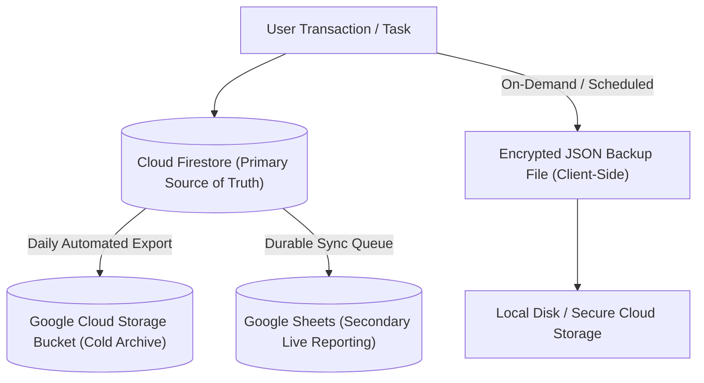

# FocusFlow & Finance — Backup & Disaster Recovery Guide

> [!NOTE]
> **DEPRECATION NOTICE:** This document has been superseded by the canonical [BACKUP_RECOVERY_GUIDE.md](BACKUP_RECOVERY_GUIDE.md). Please refer to the updated guide for current architecture, Point-in-Time Recovery (PITR), and disaster recovery procedures.

This document defines the data protection, backup schedules, recovery protocols, and disaster recovery objectives for FocusFlow & Finance.

---

## 1. Disaster Recovery Objectives

- **Recovery Point Objective (RPO):** $< 24$ hours for automated cold backups; $< 5$ minutes for Google Sheets secondary synchronization.
- **Recovery Time Objective (RTO):** $< 30$ minutes for full database restoration; $< 2$ minutes for user-level JSON file restore.

---

## 2. Backup Architecture & Layers

FocusFlow & Finance employs a multi-tiered backup architecture ensuring zero single-point-of-failure:



1. **Tier 1 (Automated Managed Export):** Google Cloud Firestore automated daily backup to Google Cloud Storage (GCS).
2. **Tier 2 (Secondary Live Reporting):** Continuous replication to Google Sheets via backend durable queue.
3. **Tier 3 (User-Initiated JSON Snapshot):** Full workspace export via the **Data Recovery Center** (`/api/backup/export`).
4. **Tier 4 (Trash & Audit Log Soft-Deletes):** 30-day non-destructive recovery window for deleted tasks, bills, and transactions.

---

## 3. Automated Firestore Managed Backups (GCP)

### 3.1 Setup Cloud Storage Bucket
Create a dedicated bucket with Coldline or Nearline storage class in the database region:

```bash
gcloud storage buckets create gs://focusflow-firestore-backups-prod \
  --location=asia-south1 \
  --default-storage-class=NEARLINE
```

### 3.2 Scheduled Nightly Export (Cloud Scheduler + Cloud Function)
Configure a daily Cloud Scheduler cron job (e.g., `0 2 * * *` at 2:00 AM IST) executing:

```bash
gcloud firestore export gs://focusflow-firestore-backups-prod/backups/$(date +%Y-%m-%d) \
  --project=YOUR_PRODUCTION_PROJECT_ID
```

### 3.3 Lifecycle Retention Policy
Apply a 30-day lifecycle expiration rule to the backup bucket:
```json
{
  "rule": [
    {
      "action": {"type": "Delete"},
      "condition": {"age": 30}
    }
  ]
}
```
Save as `lifecycle.json` and apply:
```bash
gcloud storage buckets update gs://focusflow-firestore-backups-prod --lifecycle-file=lifecycle.json
```

---

## 4. Disaster Recovery Restorations

### 4.1 Full Firestore Database Restore (Disaster Scenario)
To restore the entire production database from a daily GCS snapshot:

```bash
# 1. Inspect available snapshots
gcloud storage ls gs://focusflow-firestore-backups-prod/backups/

# 2. Execute import to Cloud Firestore
gcloud firestore import gs://focusflow-firestore-backups-prod/backups/2026-11-12/ \
  --project=YOUR_PRODUCTION_PROJECT_ID
```

### 4.2 Granular User-Level JSON Backup & Restore
If a single user experiences accidental deletion or data corruption:

1. **Export Snapshot:**
   The user navigates to **Settings > Data Recovery Center** and clicks **Export Complete Backup**, downloading `focusflow-backup-YYYY-MM-DD.json`.
2. **Restore Snapshot:**
   Under **Data Recovery Center**, click **Restore from Backup** and select the JSON backup file. The backend validates schema structures and idempotently upserts missing records without overwriting newer data.

### 4.3 Restoring Soft-Deleted Items from Trash
1. Navigate to **Data Recovery Center > Trashed Items**.
2. Filter by Entity Type (Tasks, Bills, Transactions, Envelopes, Subscriptions).
3. Click **Restore** next to any item deleted within the past 30 days. The `deletedAt` timestamp is reset to `null` and an audit entry is created.

### 4.4 Google Sheets Historical Resynchronization
If Google Sheets becomes desynchronized due to external edits:
1. In the app header or settings, click **Re-sync to Sheets**.
2. Trigger **Historical Resync**: the backend batches all existing expenses, incomes, and bills, checks existing sheet row IDs, and appends all missing records idempotently.

---

## 5. Backup Verification Drills

Perform a quarterly backup restoration rehearsal in a staging environment:
1. Export production data to a test bucket.
2. Import snapshot into a staging project (`focusflow-staging`).
3. Run the automated test suite `npm run validate` against the restored database to confirm referential integrity, payment history links, and date boundaries.

