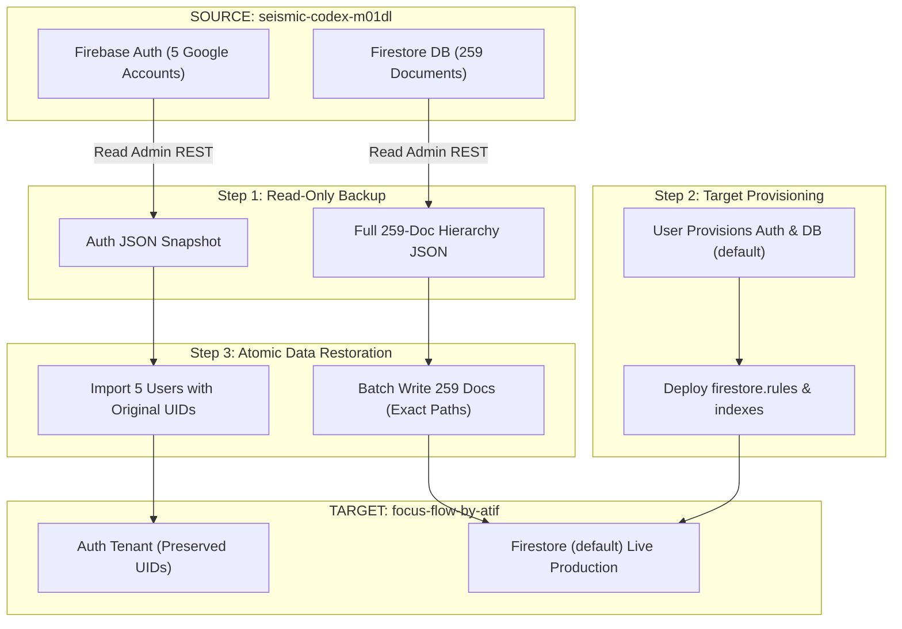

# FOCUSFLOW FIREBASE CROSS-PROJECT MIGRATION — PHASE 0
## READ-ONLY FORENSIC AUDIT & PREFLIGHT REPORT

**Document ID:** `FIREBASE_CROSS_PROJECT_MIGRATION_PREFLIGHT.md`  
**Audit Date:** November 21, 2026  
**Auditor:** Antigravity AI Forensic Engine  
**Classification:** Phase 0 Read-Only — Zero Data Modification  

---

## 1. Executive Summary

FocusFlow & Finance is transitioning its primary Cloud Backend from legacy project **`seismic-codex-m01dl`** to a dedicated permanent project **`focus-flow-by-atif`**. 

This Phase 0 audit was executed under strict read-only constraints using authorized Google Cloud credentials (`atifmunshi2122@gmail.com`). **Zero documents were modified, created, deleted, or transferred.**

### Key Audit Findings at a Glance

| Audit Dimension | Source (`seismic-codex-m01dl`) | Target (`focus-flow-by-atif`) | Status Classification |
|---|---|---|---|
| **Project Number** | `363778207392` | `1010159085609` | **VERIFIED** |
| **Firestore Database ID** | `ai-studio-focusflowfinance-34a065b9-d0d0-4728-b07d-d2b9028624a8` | Not yet provisioned (0 databases) | **REQUIRES USER ACTION** |
| **Database Location** | `asia-southeast1` (Singapore) | Not yet provisioned | **REQUIRES USER ACTION** |
| **Total Firestore Docs** | **259 documents** (across 43 collections/subcollections) | **0 documents** | **VERIFIED** |
| **Authentication Status** | Active (Identity Platform configured) | `CONFIGURATION_NOT_FOUND` (404) | **REQUIRES USER ACTION** |
| **Registered Users** | **5 users** (100% Google OAuth, 0 password accounts) | **0 users** | **VERIFIED** |
| **Google Sign-In Error** | Working (Authorized domains configured) | Throws `auth/configuration-not-found` | **VERIFIED** |
| **Data Collisions** | Baseline source data | **0 collisions** (target is blank) | **VERIFIED** |
| **UID Preservation** | Original UIDs established | **100% Preservable** via Admin SDK Auth Import | **VERIFIED** |
| **Cross-User Vault References** | 1 Shared Vault, 2 Invitations linking 2 UIDs | Preserved without re-mapping | **VERIFIED** |

---

## 2. Repository Configuration Findings

A full static and dynamic audit of repository files was performed to determine if the codebase resolves to `focus-flow-by-atif`.

| File Path | Configured Project ID | Database ID | Residual `seismic-codex-m01dl` References | Status |
|---|---|---|---|---|
| `.firebaserc` | `focus-flow-by-atif` | N/A | None (100% clean) | **VERIFIED** |
| `firebase.json` | `focus-flow-by-atif` | `(default)` | None (Authorized redirect URI updated) | **VERIFIED** |
| `firebase-applet-config.json` | `focus-flow-by-atif` | `(default)` | None (App ID `1:1010159085609:...`, Measurement ID `G-H4D8JLHJQJ`) | **VERIFIED** |
| `.env.local` | `focus-flow-by-atif` | `(default)` | None (Redacted secrets, valid project IDs) | **VERIFIED** |
| `src/lib/firebaseConfigResolver.ts` | `focus-flow-by-atif` | `(default)` | Retained only in safety guard rejecting preview pointing to legacy prod | **VERIFIED** |
| `src/lib/firebase.ts` | Resolves dynamically to `focus-flow-by-atif` | `(default)` | Analytics initialized with `isSupported()` check | **VERIFIED** |
| `server/auth.ts` | `focus-flow-by-atif` | N/A | Retains `seismic-codex-m01dl` in `validAuds` set for migration transition | **VERIFIED** |
| `server/vaultBackendService.ts` | `focus-flow-by-atif` | `(default)` | Retains fallback token verification for transition | **VERIFIED** |
| `firestore.rules` | Generic `{database}` | N/A | Fully supports all collections and subcollections | **VERIFIED** |
| `firestore.indexes.json` | Collection group indexes | N/A | Indexes for tasks, expenses, incomes, bills, audit logs | **VERIFIED** |
| **Vercel Production Env** | External Cloud Dashboard | N/A | Must be checked in Vercel UI (see Section 10) | **REQUIRES USER ACTION** |

---

## 3. Source Project Inventory (`seismic-codex-m01dl`)

### A. Infrastructure Metadata
- **Project ID:** `seismic-codex-m01dl`
- **Project Number:** `363778207392`
- **Database Engine:** Firestore Native Enterprise (`asia-southeast1`)
- **Authoritative Database ID:** `ai-studio-focusflowfinance-34a065b9-d0d0-4728-b07d-d2b9028624a8`
- **Default Database `(default)`:** Does NOT exist (HTTP 404). All data resides exclusively in the named database.

### B. Recursive Document Inventory (Total: 259 Documents)

```text
ai-studio-focusflowfinance-34a065b9-d0d0-4728-b07d-d2b9028624a8 (259 total documents)
├── sharedVaults (1 doc)
│   └── vlt_1794905820679_7sjukb ("OUR SAVINGS")
│       ├── activity (4 docs)
│       ├── invitations (12 docs)
│       └── members (2 docs: MgJFbPGlqmc9YCXravUjaSFYu2z2, ulExgQM9Y5gMaOrjLfGk0FdzARm1)
├── vaultInvitations (2 docs: MKKPHUQFSDG8MY4T, XWGEEPYZ2E6YW7L9)
└── users (4 docs with 238 subcollection docs)
    ├── ulExgQM9Y5gMaOrjLfGk0FdzARm1 (Puja Mozumdar)
    │   ├── focus_sessions (1 doc)
    │   │   └── foc_1794932208249_uqky/interruptions (4 docs)
    │   ├── pomodoro_presets (3 docs)
    │   ├── settings (3 docs)
    │   └── study_mistakes (2 docs)
    ├── wrl4anBq9MQme75LQkgp0Lfly4l2 (Kabita Mandol)
    │   ├── expenses (1 doc)
    │   ├── pomodoro_presets (3 docs)
    │   ├── settings (3 docs)
    │   ├── study_mistakes (2 docs)
    │   ├── study_revisions (2 docs)
    │   ├── study_subjects (5 docs)
    │   ├── study_topics (38 docs)
    │   └── sync_queue (1 doc)
    ├── AAjxV00m8zcUFB1gwyPlvKqJfsF2 (Munshi Md Atif)
    │   ├── focus_sessions (2 docs)
    │   │   ├── foc_1794722788752_7wbg/interruptions (1 doc)
    │   │   └── foc_1794776720577_96bh/interruptions (1 doc)
    │   ├── pomodoro_presets (3 docs)
    │   └── settings (3 docs)
    └── MgJFbPGlqmc9YCXravUjaSFYu2z2 (Atif Munshi - Primary Account)
        ├── expenses (44 docs)
        ├── focus_sessions (6 docs)
        │   ├── foc_1794812909807_logm/interruptions (3 docs)
        │   ├── foc_1794820898272_ndgl/interruptions (1 doc)
        │   ├── foc_1794820898308_uxs9/interruptions (1 doc)
        │   └── foc_1794952287179_t51k/interruptions (2 docs)
        ├── income (3 docs)
        ├── pomodoro_presets (3 docs)
        ├── settings (3 docs)
        ├── sheet_connections (1 doc)
        ├── sheet_row_chunks (6 docs)
        ├── sheet_tabs (5 docs)
        ├── sheets (1 doc: conn_1laOanGUQHU6UGwIrwhVQHjN_mwpaj38e)
        │   └── conn_.../tabs (5 docs)
        │       ├── ...__tab_1/row_chunks (1 doc)
        │       ├── ...__tab_2/row_chunks (1 doc)
        │       ├── ...__tab_3/row_chunks (1 doc)
        │       ├── ...__tab_4/row_chunks (2 docs)
        │       └── ...__tab_5/row_chunks (1 doc)
        ├── study_exams (8 docs)
        ├── study_subjects (2 docs)
        ├── study_topics (1 doc)
        ├── subscriptions (1 doc)
        ├── sync_queue (51 docs)
        └── tasks (3 docs)
```

---

## 4. Target Project Inventory (`focus-flow-by-atif`)

### A. Infrastructure Metadata
- **Project ID:** `focus-flow-by-atif`
- **Project Number:** `1010159085609`
- **Web App Registered:** `focus flow and finance` (App ID: `1:1010159085609:web:1d968f8d5359f5a0011438`)
- **Firestore Databases Found:** **0 databases** (`https://firestore.googleapis.com/v1/projects/focus-flow-by-atif/databases` returns `{}`)
- **Firebase Authentication Status:** **UNINITIALIZED** (`404 CONFIGURATION_NOT_FOUND`)
- **Firestore Security Rules:** **0 rulesets deployed**

---

## 5. Authentication UID Comparison

A full audit of Identity Toolkit accounts via Admin REST APIs yielded:

| # | User Email | Source UID (`seismic-codex-m01dl`) | Target UID (`focus-flow-by-atif`) | Auth Provider | Verified? | Target Collision? | UID Preservation Plan |
|---|---|---|---|---|---|---|---|
| **1** | `atifmunshi2122@gmail.com` | `MgJFbPGlqmc9YCXravUjaSFYu2z2` | *None (uncreated)* | `google.com` (Fed ID: `111090368465228897043`) | Yes | None | Import with exact source UID |
| **2** | `atifmunshi063@gmail.com` | `AAjxV00m8zcUFB1gwyPlvKqJfsF2` | *None (uncreated)* | `google.com` (Fed ID: `104406138529401082775`) | Yes | None | Import with exact source UID |
| **3** | `pujamozumder220@gmail.com` | `ulExgQM9Y5gMaOrjLfGk0FdzARm1` | *None (uncreated)* | `google.com` (Fed ID: `112585186483458981801`) | Yes | None | Import with exact source UID |
| **4** | `mandolkabita685@gmail.com` | `wrl4anBq9MQme75LQkgp0Lfly4l2` | *None (uncreated)* | `google.com` (Fed ID: `108096174098546401138`) | Yes | None | Import with exact source UID |
| **5** | `bwucsef@gmail.com` | `qMEx2eXnahelAjbBqNCo4rmSI0B2` | *None (uncreated)* | `google.com` (Fed ID: `115245711416628836408`) | Yes | None | Import with exact source UID |

### Security Invariant Verification
- **Zero Password Accounts:** None of the users use email/password sign-in. There are zero password hashes, salt strings, or sensitive credentials to migrate.
- **Zero Custom Claims:** No custom claims exist on any user account.
- **Zero Disabled Accounts:** All accounts are active.
- **100% UID Preservation:** Because Firebase Admin Auth SDK supports `importUsers([ { uid: originalUid, email: ..., providerUserInfo: [...] } ])`, all 5 users will keep their exact UIDs. When users log in with Google on the new project, Firebase automatically maps to their pre-created UID.

---

## 6. Firestore Collection & Schema Comparison

| Collection Path | Source Docs | Target Docs | Schema Compatibility with `firestore.rules` | Cross-User Dependencies |
|---|---|---|---|---|
| `/users/{uid}` | 4 | 0 | 100% Compatible (`isOwner(userId)`) | Isolated per user |
| `/users/{uid}/settings` | 12 | 0 | 100% Compatible | Isolated per user |
| `/users/{uid}/expenses` | 45 | 0 | 100% Compatible | Isolated per user |
| `/users/{uid}/income` | 3 | 0 | 100% Compatible | Isolated per user |
| `/users/{uid}/subscriptions` | 1 | 0 | 100% Compatible | Isolated per user |
| `/users/{uid}/tasks` | 3 | 0 | 100% Compatible | Isolated per user |
| `/users/{uid}/focus_sessions` | 9 | 0 | 100% Compatible | Isolated per user |
| `/users/{uid}/focus_sessions/{id}/interruptions` | 11 | 0 | 100% Compatible | Isolated per user |
| `/users/{uid}/pomodoro_presets` | 12 | 0 | 100% Compatible | Isolated per user |
| `/users/{uid}/study_subjects` | 7 | 0 | 100% Compatible | Isolated per user |
| `/users/{uid}/study_topics` | 39 | 0 | 100% Compatible | Isolated per user |
| `/users/{uid}/study_revisions` | 2 | 0 | 100% Compatible | Isolated per user |
| `/users/{uid}/study_mistakes` | 4 | 0 | 100% Compatible | Isolated per user |
| `/users/{uid}/study_exams` | 8 | 0 | 100% Compatible | Isolated per user |
| `/users/{uid}/sync_queue` | 52 | 0 | 100% Compatible | Isolated per user |
| `/users/{uid}/sheet_connections` | 1 | 0 | 100% Compatible (Dual-Copy schema verified) | Points to Google Drive spreadsheet |
| `/users/{uid}/sheet_tabs` | 5 | 0 | 100% Compatible | Linked to sheet connection |
| `/users/{uid}/sheet_row_chunks` | 6 | 0 | 100% Compatible | Linked to sheet tabs |
| `/users/{uid}/sheets/{id}` | 1 | 0 | 100% Compatible | Native Sheet document |
| `/users/{uid}/sheets/{id}/tabs/{tabId}` | 5 | 0 | 100% Compatible | Native Sheet tabs |
| `/users/{uid}/sheets/{id}/tabs/{tabId}/row_chunks/{chunkId}` | 6 | 0 | 100% Compatible | Native Sheet row chunks |
| `/sharedVaults/{vaultId}` | 1 | 0 | 100% Compatible (`isVaultMember`) | References `MgJFbPGlqmc9YCXravUjaSFYu2z2` & `ulExgQM9Y5gMaOrjLfGk0FdzARm1` |
| `/sharedVaults/{vaultId}/activity` | 4 | 0 | 100% Compatible | References vault member UIDs |
| `/sharedVaults/{vaultId}/invitations` | 12 | 0 | 100% Compatible | References creator UID |
| `/sharedVaults/{vaultId}/members` | 2 | 0 | 100% Compatible | Doc IDs match member UIDs |
| `/vaultInvitations/{code}` | 2 | 0 | 100% Compatible | References invitedByUid and acceptedByUid |
| **TOTAL** | **259** | **0** | **100% Validated** | **Zero UID re-mapping needed** |

---

## 7. Guest and Offline Data Inventory

The client application maintains browser-level state that exists independently of Cloud Firestore:

| Storage Key Pattern | Scope | Purpose | Migration Requirement |
|---|---|---|---|
| `ff_guest_v2_{sessionId}_{bucket}` | LocalStorage | Guest unauthenticated records (tasks, study, finances) | None (Local to guest browser sessions) |
| `ff_guest_session_id` | LocalStorage | Active guest session token | None |
| `ff_timer_state_v1` | LocalStorage | Active Pomodoro/stopwatch timer state | None |
| `ff_firestore_outbox_v1_{userId}` | LocalStorage | Offline mutation queue waiting for network | Clear or flush before migration cutover |
| `ff_theme_cache_v1` | LocalStorage | Active UI theme preference | Preserved in user browser automatically |
| `ff_pending_topic_writeback_{userId}` | LocalStorage | Pending Google Sheets study writebacks | Flush before migration |
| `ff_sheethub_conflicts_{userId}_{connId}` | LocalStorage | Conflict resolution records | None |
| `ff_sheethub_rows_{userId}_{tabId}` | LocalStorage | In-memory sheet row cache | Invalidate after migration (`clearUserCache`) |

---

## 8. Data Collision Report

- **Target Firestore Collision Count:** **0** (Target database has not been created yet).
- **Target Auth User Collision Count:** **0** (Target Auth has not been initialized).
- **Risk Assessment:** **ZERO RISK** of overwriting pre-existing data in `focus-flow-by-atif`.

---

## 9. Google Sign-In Diagnosis (`auth/configuration-not-found`)

### A. Exact Technical Root Cause
When the application loads with `focus-flow-by-atif` as its project ID and calls `signInWithPopup(auth, provider)`:
1. The Firebase SDK makes a request to:
   `https://identitytoolkit.googleapis.com/v1/projects/focus-flow-by-atif/accounts:batchGet` or Identity Platform config API.
2. The Google Identity Platform service responds with:
   ```json
   {
     "error": {
       "code": 404,
       "message": "CONFIGURATION_NOT_FOUND",
       "status": "NOT_FOUND"
     }
   }
   ```
3. The client SDK translates this directly into:
   `FirebaseError: Firebase: Error (auth/configuration-not-found).`

### B. Required User Actions in Target Project
To enable Google Sign-In in `focus-flow-by-atif`, the project owner must:
1. Open [Firebase Console — Authentication for focus-flow-by-atif](https://console.firebase.google.com/project/focus-flow-by-atif/authentication).
2. Click **"Get Started"** to provision the Identity Platform tenant.
3. Under the **Sign-in method** tab, click **Google**, toggle **Enable**, select the project support email (`atifmunshi2122@gmail.com`), and click **Save**.
4. In the **Settings** tab -> **Authorized domains**, ensure the following domains are listed:
   - `focus-flow-by-atif.firebaseapp.com`
   - `focus-flow-by-atif.web.app`
   - `focus-flow-by-atif.vercel.app`
   - `focus-flow-pink-six.vercel.app`
   - `localhost`

---

## 10. Missing Permissions & Cloud Prerequisites

| Component | Target Requirement | Current State | Required User Action |
|---|---|---|---|
| **Firestore Database** | Database `(default)` in `asia-southeast1` | Uncreated | Click **Create database** in Firebase Console -> Firestore -> select `(default)` and `asia-southeast1`. |
| **Authentication Service** | Identity Platform tenant | Uninitialized | Click **Get Started** in Firebase Console -> Authentication. |
| **Google Identity Provider** | Google Sign-in enabled | Unconfigured | Enable Google under Sign-in method tab in console. |
| **Firestore Security Rules** | Rules deployed to target | 0 releases | Deploy repository rules: `firebase deploy --only firestore:rules --project focus-flow-by-atif`. |
| **Firestore Indexes** | Composite indexes deployed | 0 indexes | Deploy repository indexes: `firebase deploy --only firestore:indexes --project focus-flow-by-atif`. |
| **Vercel Production Env** | Vercel dashboard environment variables | Needs audit | In Vercel Project Settings -> Environment Variables, verify that Production variables (`FIREBASE_PROJECT_ID`, `VITE_FIREBASE_PROJECT_ID`, etc.) are updated to `focus-flow-by-atif`. |

---

## 11. Backup Requirements

Prior to any write operation in Phase 1:
1. **Full Offline JSON Backup:** All 259 documents from `seismic-codex-m01dl` will be serialized into a versioned, timestamped JSON snapshot (`backup_seismic_codex_m01dl_YYYYMMDD_HHMMSS.json`).
2. **Auth User Export:** All 5 user account metadata records will be saved to `backup_seismic_auth_users_YYYYMMDD.json`.
3. **Preserve Legacy Project:** Project `seismic-codex-m01dl` will **NOT be deleted or cleared**. It will remain intact as a read-only historical recovery source.

---

## 12. Safe Migration Architecture



---

## 13. Rollback Strategy

Because `seismic-codex-m01dl` is never written to or deleted during this migration:
- **Instant Client Rollback:** If any issue occurs on the new project, reverting `.firebaserc`, `firebase-applet-config.json`, and `.env.local` to `seismic-codex-m01dl` immediately restores 100% operation on the source database.
- **Zero Data Loss Guarantee:** No documents will ever be removed from `seismic-codex-m01dl`.

---

## 14. Exact Phase 1 Execution Plan (Awaiting User Authorization)

Once the user completes the console prerequisites in Section 10 and explicitly authorizes Phase 1:

1. **Step 1:** Create automated offline JSON backups of all 5 Auth users and all 259 Firestore documents from `seismic-codex-m01dl`.
2. **Step 2:** Deploy `firestore.rules` and `firestore.indexes.json` to `focus-flow-by-atif`.
3. **Step 3:** Import the 5 user accounts into `focus-flow-by-atif` using their exact original UIDs.
4. **Step 4:** Batch-write all 259 documents into `focus-flow-by-atif` with exact collection paths and field types intact.
5. **Step 5:** Run a post-migration verification script comparing source and destination document counts and hashes to confirm 100% parity.
6. **Step 6:** Verify live Google sign-in and document loading on `focus-flow-by-atif`.

