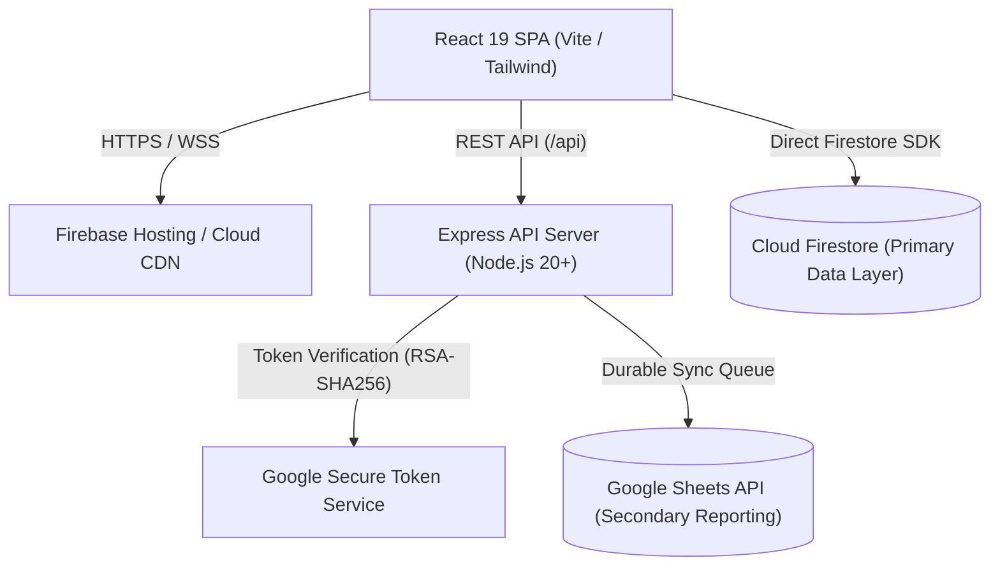

# FocusFlow & Finance — Production Deployment Guide

## 1. Architectural Overview

FocusFlow & Finance is built as a high-performance, deterministic productivity and financial tracking platform:
- **Client Tier:** React 19 single-page application bundled with Vite and Tailwind CSS.
- **Backend Tier:** Express.js API server running on Node.js 20+ providing security headers, sliding-window rate limiting, token authentication, and data integrity middleware.
- **Primary Data Layer:** Google Cloud Firestore (NoSQL, multi-tenant subcollection isolation, client SDK with offline persistence).
- **Secondary Sync Layer:** Google Sheets API integration via server-side durable queue with exponential backoff and retry handling.



---

## 2. Prerequisites & Requirements

- **Node.js:** v20.x or v22.x LTS.
- **Firebase CLI:** v13.x+ installed (`npm install -g firebase-tools`).
- **Google Cloud / Firebase Project:** Active project with Blaze (pay-as-you-go) plan enabled for external Google Sheets API calls and Cloud Run / Functions execution.
- **Custom Domain:** Configured DNS management for custom domain and automated SSL/TLS provisioning.

---

## 3. Recommended Hosting Strategy

### Option A: Unified Container on Google Cloud Run (Recommended)
Host the combined static client and Express backend in a single autoscaling container service.
- **Pros:** Zero CORS configuration issues, single deployment artifact, atomic deployments, automatic HTTPS, sub-second cold starts.
- **Target:** Google Cloud Run (Region: `asia-south1` or regional proximity to users).

### Option B: Firebase-Native Split Architecture
- **Frontend:** Firebase Hosting (`dist/`) distributing assets via Google's global CDN edge.
- **Backend:** Cloud Run or Cloud Functions v2 for `/api/**` rewrites configured via [firebase.json](file:///Users/munshimdatif/Downloads/focusflow-&-finance/firebase.json).

---

## 4. Production Build & Validation

Execute the automated validation suite before any deployment:

```bash
# 1. Typecheck and run all 20 automated regression tests
npm run validate

# 2. Perform clean production build with asset optimization
npm run build:prod
```

Verification output checklist:
- [x] TypeScript compiler passes with 0 errors (`tsc --noEmit`).
- [x] Test suite executes with 100% pass rate (20/20 tests passing).
- [x] Vite output chunks split into optimized vendor bundles:
  - `dist/assets/vendor-firebase-*.js` (~168 kB gzipped)
  - `dist/assets/vendor-react-*.js` (~123 kB gzipped)
  - `dist/assets/vendor-motion-*.js` (~43 kB gzipped)
  - `dist/assets/vendor-lucide-*.js` (~15 kB gzipped)
  - `dist/assets/index-*.js` (~157 kB gzipped)

---

## 5. Docker Deployment (Cloud Run / Container Platforms)

Create a production Dockerfile in the project root:

```dockerfile
# Multi-stage production Dockerfile
FROM node:22-alpine AS builder
WORKDIR /app
COPY package*.json ./
RUN npm ci
COPY . .
RUN npm run validate
RUN npm run build:prod

FROM node:22-alpine AS runner
WORKDIR /app
ENV NODE_ENV=production
ENV PORT=8080
COPY package*.json ./
RUN npm ci --omit=dev
COPY --from=builder /app/dist ./dist
COPY --from=builder /app/server.ts ./server.ts
COPY --from=builder /app/server ./server
COPY --from=builder /app/src/types ./src/types
COPY --from=builder /app/src/lib/dateTime.ts ./src/lib/dateTime.ts
COPY --from=builder /app/src/lib/currency.ts ./src/lib/currency.ts
COPY --from=builder /app/data ./data

# Use non-root node user for container security
USER node
EXPOSE 8080
CMD ["npx", "tsx", "server.ts"]
```

### Build & Deploy Commands:
```bash
# Authenticate with Google Cloud
gcloud auth login
gcloud config set project YOUR_PROJECT_ID

# Build container image via Google Cloud Build
gcloud builds submit --tag gcr.io/YOUR_PROJECT_ID/focusflow-app:v1.0.0

# Deploy container to Cloud Run
gcloud run deploy focusflow-app \
  --image gcr.io/YOUR_PROJECT_ID/focusflow-app:v1.0.0 \
  --platform managed \
  --region asia-south1 \
  --allow-unauthenticated \
  --set-env-vars NODE_ENV=production,REQUIRE_AUTH=true,APP_URL=https://focusflow.yourdomain.com
```

---

## 6. Firebase Hosting Deployment

If deploying frontend assets to Firebase Hosting:

```bash
# 1. Login to Firebase
firebase login

# 2. Select the target production Firebase project
firebase use --add YOUR_PROJECT_ID

# 3. Deploy Firestore rules and indexes
firebase deploy --only firestore:rules,firestore:indexes

# 4. Deploy static frontend hosting
firebase deploy --only hosting
```

---

## 7. Health Checks & Uptime Monitoring

The backend exposes two unauthenticated monitoring endpoints:
- `GET /health`
- `GET /api/health`

**Sample Response (`200 OK`):**
```json
{
  "status": "healthy",
  "timestamp": "2026-11-12T16:50:00.000Z",
  "uptimeSeconds": 14502,
  "environment": "production",
  "version": "1.0.0"
}
```

Configure an uptime check in Google Cloud Monitoring or an external monitor (e.g., BetterStack, UptimeRobot):
- **URL:** `https://focusflow.yourdomain.com/health`
- **Interval:** 60 seconds
- **Timeout:** 5 seconds
- **Expected Status:** `200`

---

## 8. Rollback & Emergency Recovery

In the event of an unexpected regression or deployment defect:
1. **Cloud Run Instant Rollback:**
   ```bash
   # Route 100% of traffic to the previous healthy revision
   gcloud run services update-traffic focusflow-app \
     --to-revisions=PREVIOUS_REVISION_NAME=100 \
     --region=asia-south1
   ```
2. **Firebase Hosting Rollback:**
   ```bash
   # Revert hosting release in Firebase Console or via CLI
   firebase hosting:clone YOUR_PROJECT_ID:PREVIOUS_VERSION YOUR_PROJECT_ID:live
   ```
3. **Database Restorations:** Follow the procedures in [BACKUP_RECOVERY_GUIDE.md](BACKUP_RECOVERY_GUIDE.md).

