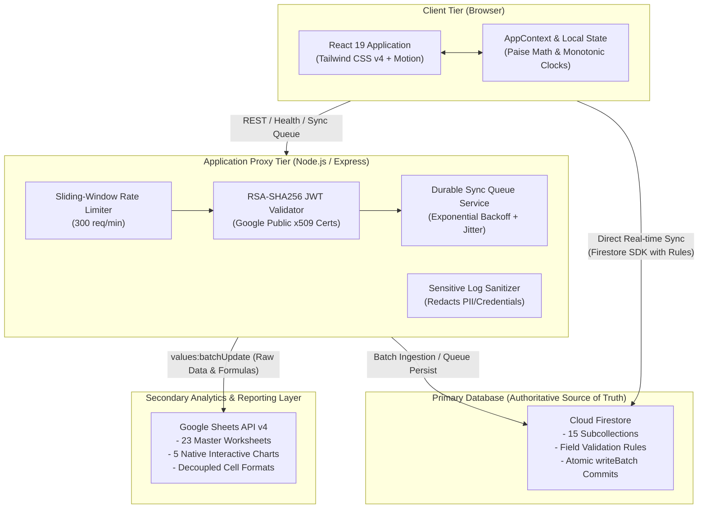
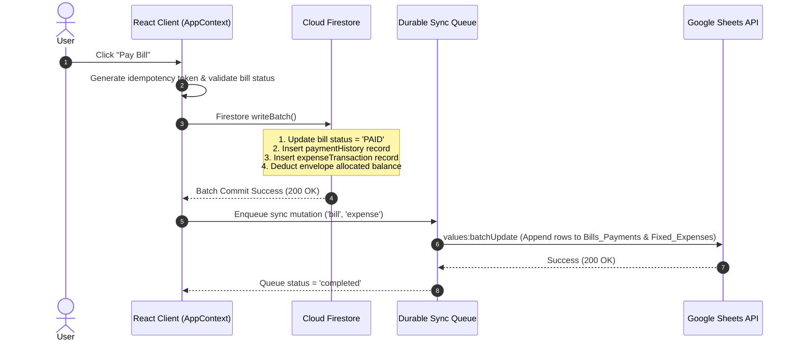

# System Architecture Specification

**FocusFlow & Finance** is an enterprise-grade, deterministic productivity and personal finance management platform. This document specifies the comprehensive system architecture, data flow paths, security boundaries, and component interactions.

---

## 1. High-Level Architectural Topology



---

## 2. Core Architectural Pillars

### 2.1 Single Authoritative Source of Truth (Cloud Firestore)
- **Role:** Primary database storing all user accounts, tasks, focus sessions, financial transactions, envelopes, and bills.
- **Data Integrity:** Double-entry consistency via integer paise ($1\text{ INR} = 100\text{ paise}$).
- **Security Boundaries:** Enforced via `firestore.rules` preventing cross-user data leakage and validating document schemas at the database engine level.

### 2.2 Secondary Analytical Reporting Layer (Google Sheets)
- **Role:** Read-only executive presentation, automated formulas, and data export.
- **Decoupled Architecture:** Schema formatting (`batchUpdate`) runs once during initialization to configure headers, banding, cell borders, number formats (`₹#,##0.00`), dropdowns, and 5 native charts. Routine sync invokes `values:batchUpdate`, preserving visual formatting completely.
- **Non-Destructive Resync:** Historical rebuilds clear data cells only (`values:batchClear` on `A2:Z`) while keeping Row 1 headers and chart definitions untouched.

### 2.3 Express Security & Ingestion Proxy
- **Role:** Handles protected server-side integrations, rate limiting, and durable sync orchestration.
- **Token Verification:** Verifies Google OAuth2 ID tokens and Firebase JWTs server-side before processing requests.
- **Rate Limiting:** Protects backend endpoints against brute force and denial-of-service using a memory-efficient sliding-window algorithm.

---

## 3. Data Flow & Transaction Sequences

### 3.1 Atomic Bill Payment & Financial Ledger Update



---

## 4. Subsystem Specifications

### 4.1 Financial Engine (`src/lib/financial.ts`)
- **Arithmetic Rule:** Strict integer math. All amounts are multiplied by 100 upon input and formatted with `Intl.NumberFormat('en-IN', { style: 'currency', currency: 'INR' })`.
- **Classification Engine:** Segregates expenses into Fixed (Rent, Utilities, Insurance, Subscriptions) and Variable (Groceries, Dining, Travel, Leisure).
- **Audit Trails:** Reversed payments retain the original transaction with `status: 'reversed'`, recording the timestamp and operator ID.

### 4.2 Time & Recurrence Engine (`src/lib/dateTime.ts`)
- **Timezone Standard:** Locked to `Asia/Kolkata` (`UTC+05:30`) with full UTC serialization.
- **Recurrence Logic:** Month-end clamping ensures that a bill due on the 31st defaults to the 28th/29th of February or the 30th of April without overflowing into subsequent months.
- **Idempotency Keys:** Recurring generation formats composite keys: `rec_{ruleId}_{YYYY-MM}`.

### 4.3 Google Sheets 23-Worksheet Architecture (`src/lib/googleSheetsService.ts`)
The workbook structure spans 23 dedicated worksheets with deterministic integer `sheetId`s:

```
[100] Executive_Dashboard ★    [108] Focus_Monthly           [116] Budgets
[101] Finance_Dashboard        [109] Tasks                   [117] Savings_Goals
[102] Productivity_Dashboard   [110] Task_Analytics          [118] Finance_Daily
[103] Focus_Sessions           [111] Productivity_Goals      [119] Finance_Weekly
[104] Focus_Daily              [112] Income                  [120] Finance_Monthly
[105] Focus_Weekly             [113] Fixed_Expenses          [121] Sync_Log
[106] Focus_Monthly            [114] Variable_Expenses       [122] Settings
[107] Focus_Weekly             [115] Bills_Payments
```

Embedded native charts:
1. **Income vs. Expense Column Chart** (`Executive_Dashboard` at row 17)
2. **Weekly Focus Hours Trendline** (`Productivity_Dashboard` at row 18)
3. **Fixed vs. Variable Expense Donut** (`Finance_Dashboard` at row 18)
4. **Net Savings Trajectory Area Chart** (`Finance_Dashboard` at row 34)
5. **Pomodoro Completion Frequency Column** (`Productivity_Dashboard` at row 34)

---

## 5. Security & Isolation Matrix

| Component | Security Mechanism | Threat Mitigation |
| :--- | :--- | :--- |
| **Client Routing** | Route guards and authentication state listeners | Prevents unauthorized UI access |
| **API Endpoints** | In-memory sliding-window rate limiter (300 req/min) | Mitigates brute-force and DoS attacks |
| **Authentication** | Cryptographic RSA-SHA256 signature verification | Prevents token spoofing and identity forgery |
| **Firestore Database** | Subcollection isolation & strict field validation rules | Enforces strict multi-tenant data boundaries |
| **Logging Subsystem** | Regex-based credential and PII masking | Prevents credential leaks in monitoring logs |
| **HTTP Transport** | `Strict-Transport-Security`, `nosniff`, `SAMEORIGIN` | Defends against MITM, clickjacking, MIME-sniffing |
