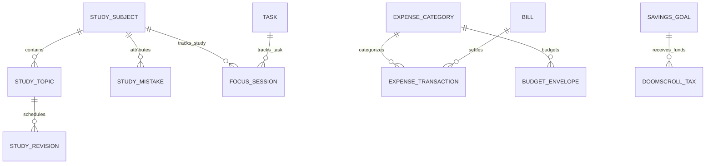

# FocusFlow & Finance — Advanced Graph Studio Audit
**Project:** FocusFlow & Finance v1.7.0 / v1.8.0  
**Document:** `docs/GRAPH_STUDIO_AUDIT.md`  
**Role:** Senior Frontend Developer, Data Visualization Architect, and QA Engineer  
**Status:** Audit & Architectural Blueprint Complete (Zero AI, Zero External Dependencies)

---

## 1. Executive Summary & Purpose

The purpose of this audit is to conduct a forensic, comprehensive inspection of all data visualization assets, underlying datasets, aggregation pipelines, and chart rendering mechanisms currently deployed in **FocusFlow & Finance**. 

As the application has scaled from a personal productivity tracker to an enterprise-grade suite encompassing **Finance & Cash Flow Management**, **Deep Work & Pomodoro Intelligence**, **Study OS Academic Engine**, **Habit Consistency**, and **Specialized v1.8 Feature Modules** (Time-vs-Money, Skill Tree DAG, Life in Weeks, Doomscroll Self-Tax, Exam Simulator), data is currently siloed across individual tabs.

The goal of the **Advanced Graph Studio** is to provide a unified, interactive visualization powerhouse that surfaces deep, cross-domain insights without relying on third-party charting bloat, external cloud dependencies, or non-deterministic AI.

---

## 2. Existing Graphs & Visualizations Inventory

A thorough audit of the current codebase identified **18 distinct visualization components** across 3 primary application domains. Below is the itemized inventory analyzing source files, underlying data models, rendering techniques, functionality status, reusability, and current architectural gaps.

```
+---------------------------------------------------------------------------------------------------------+
|                                    EXISTING VISUALIZATION INVENTORY                                      |
+------------------------------------+--------------------------+--------------------+--------------------+
| Graph / Visualization Name         | Source File              | Chart Type         | Rendering Engine   |
+------------------------------------+--------------------------+--------------------+--------------------+
| 1. Income vs Expense Flow Bar      | AnalyticsCharts.tsx      | Segmented Bar      | HTML / Motion      |
| 2. Fixed vs Variable Obligation    | AnalyticsCharts.tsx      | Stacked Ratio Bar  | HTML / Motion      |
| 3. Category Spending Breakdown     | AnalyticsCharts.tsx      | Ranked Bar List    | AnimatedProgressBar|
| 4. 6-Month Financial Trajectory    | AnalyticsCharts.tsx      | Dual Column Bar    | HTML / Motion      |
| 5. Daily Spending Gauge & Limit    | DailyExpenseTracker.tsx  | Progress & Metrics | ThemeCard / Motion |
| 6. Budget Envelope Consumption     | EnvelopeBudgetManager.tsx| Budget Tracker Bar | HTML Progress Track|
| 7. Savings Goal Target Bar         | BudgetSavingsManager.tsx | Milestone Progress | HTML Progress Track|
| 8. Productivity Score Ring Gauge   | ProductivityScoreCard.tsx| Radial Gauge       | SVG Ring Path      |
| 9. Analog Clock 12-Hour Dial       | AnalogClockDial.tsx      | Radial Clock Dial  | Inline SVG         |
| 10. 7-Day Consistency Dot Matrix   | FocusAnalytics.tsx       | Grid Indicator     | CSS Grid / SVG Icon|
| 11. Last 7 Days Focus Distribution | FocusAnalytics.tsx       | Column Histogram   | HTML / Motion Bars |
| 12. 84-Day Focus Activity Heatmap  | FocusAnalytics.tsx       | Calendar Heatmap   | CSS Grid Matrix    |
| 13. Subject-Wise Focus Breakdown   | FocusAnalytics.tsx       | Ranked Progress Bar| HTML Progress Track|
| 14. 24-Hour Daily Timeline         | DailyProductivityTimeline| Gantt/Block Chart  | CSS Timeline Grid  |
| 15. Pomodoro Goal Tracking Bars    | FocusAnalytics.tsx       | Target vs Actual   | AnimatedProgressBar|
| 16. RPG Skill Tree Dependency Map  | SkillTreeLab.tsx         | DAG Directed Graph | SVG Bezier Curves  |
| 17. 90-Year Life in Weeks Grid     | LifeInWeeksGrid.tsx      | Memento Mori Grid  | HTML/CSS Box Grid  |
| 18. Whiteboard Rough-Work Canvas   | WhiteboardCanvas.tsx     | Freehand Canvas    | HTML5 Canvas 2D    |
+------------------------------------+--------------------------+--------------------+--------------------+
```

---

### Detailed Inventory Breakdown

#### 1. Income vs Expense Flow Bar
- **Source File:** `src/components/finance/AnalyticsCharts.tsx` (Lines 98–139)
- **Data Source:** `FinanceSummaryData` (`totalIncomePaise`, `totalExpensePaise`) via `api.getFinanceSummary(filter)`
- **Chart Type:** Segmented comparative horizontal bar with spring easing.
- **Functional Status:** **Fully Functional**. Correctly handles zero-income and zero-expense edges, calculates dynamic ratios, and displays formatted currency in active user currency.
- **Reusability:** **High**. Can be abstracted into a generic `ComparativeRatioBar`.
- **Missing Functionality / Limitations:** Static single-period view. Does not show historical ratio drift over multiple months; lacks hover tooltips revealing exact daily inflow/outflow balance.

#### 2. Fixed vs Variable Spending Split
- **Source File:** `src/components/finance/AnalyticsCharts.tsx` (Lines 143–206)
- **Data Source:** `FinanceSummaryData` (`fixedExpensesPaise`, `variableExpensesPaise`)
- **Chart Type:** Dual-segment progress track with recurring obligation percentage badge.
- **Functional Status:** **Fully Functional**. Correctly separates contractual bills (`Bill` / `RecurringExpense`) from discretionary card/cash expenditures.
- **Reusability:** **High**.
- **Missing Functionality / Limitations:** Only reflects the currently selected filter window (`this_month`, `last_month`). Cannot drill down into which categories constitute the variable excess.

#### 3. Category Spending Breakdown
- **Source File:** `src/components/finance/AnalyticsCharts.tsx` (Lines 210–268)
- **Data Source:** `FinanceSummaryData.categoryBreakdown` (`name`, `amountPaise`, `color`)
- **Chart Type:** Ranked horizontal bar list with category color dots and percentage share.
- **Functional Status:** **Fully Functional**. Handles empty transactions cleanly with an `EmptyStateIllustration`.
- **Reusability:** **High**.
- **Missing Functionality / Limitations:** No interactive category isolation/filtering on click; lacks hierarchical subcategory breakdown; does not show category budget threshold comparison inline.

#### 4. 6-Month Financial Trajectory Chart
- **Source File:** `src/components/finance/AnalyticsCharts.tsx` (Lines 271–355)
- **Data Source:** `FinanceSummaryData.monthlyTrend` (`month`, `incomePaise`, `expensePaise`)
- **Chart Type:** Vertical dual-column bar chart (Green for Income, Red for Expense) normalized against `maxTrend`.
- **Functional Status:** **Fully Functional**. Features staggered Framer Motion reveal animations.
- **Reusability:** **Medium**. Pure CSS height-based columns.
- **Missing Functionality / Limitations:**
  - Limited to fixed 6-month historical window.
  - Lacks hover tooltip overlays with net savings rate and monthly surplus/deficit figures.
  - No trendline or spline overlay (e.g. 3-month moving average).
  - No capability to toggle between gross columns, net cash flow, or cumulative savings.

#### 5. Daily Spending Gauge & Limit Tracker
- **Source File:** `src/components/finance/DailyExpenseTracker.tsx` (Lines 238–310)
- **Data Source:** `ExpenseTransaction[]`, `IncomeTransaction[]`, `UserSettings.dailySpendingLimitPaise`
- **Chart Type:** Linear progress bar with percentage-of-limit fill and day-over-day delta badges.
- **Functional Status:** **Fully Functional**. Computes day-level deltas vs yesterday and indicates budget breach.
- **Reusability:** **Medium**.
- **Missing Functionality / Limitations:** Lacks a 30-day sparkline showing consecutive days under/over the daily limit.

#### 6. Budget Envelope Consumption & Savings Goal Bars
- **Source Files:** `src/components/finance/EnvelopeBudgetManager.tsx`, `src/components/finance/BudgetSavingsManager.tsx`
- **Data Source:** `BudgetEnvelope[]`, `SavingsGoal[]`
- **Chart Type:** Horizontal progress indicators with threshold coloring (Green $\to$ Amber $\to$ Rose).
- **Functional Status:** **Fully Functional**.
- **Reusability:** **High**.
- **Missing Functionality / Limitations:** Isolated in individual budget tabs; not visible alongside productivity velocity or study goals.

#### 7. Deterministic Productivity Score Ring Gauge
- **Source File:** `src/components/focus/ProductivityScoreCard.tsx` (Lines 40–180)
- **Data Source:** `computeProductivityScore()` in `src/lib/productivityIntelligence.ts`
- **Chart Type:** Radial circular SVG gauge utilizing `strokeDasharray` and `strokeDashoffset` with color tiers (Mastery, Flow State, Steady Progress, Building Momentum).
- **Functional Status:** **Fully Functional & Verified**. Includes popover score breakdown modal.
- **Reusability:** **Very High**. Excellent mathematical implementation of SVG arcs.
- **Missing Functionality / Limitations:** Shows today's score only; lacks a 30-day historical score velocity line chart.

#### 8. Analog Clock 12-Hour Focus Dial
- **Source File:** `src/components/focus/AnalogClockDial.tsx`
- **Data Source:** Active Pomodoro timer state and 24-hour time block intervals.
- **Chart Type:** Circular SVG clock face with animated hands and colored active session arcs.
- **Functional Status:** **Fully Functional**.
- **Reusability:** **Medium**. Specialized for timer display.
- **Missing Functionality / Limitations:** Does not render completed historical sessions from past days on the dial.

#### 9. 7-Day Consistency Dot Matrix & Last 7 Days Focus Distribution
- **Source File:** `src/components/focus/FocusAnalytics.tsx` (Lines 526–691)
- **Data Source:** `FocusStatsData.last7Days` (`date`, `dayName`, `minutes`, `sessionsCount`)
- **Chart Type:** 7-column vertical bar histogram with hover tooltips and daily target milestone badges.
- **Functional Status:** **Fully Functional**. Falls back smoothly to client session history if server stats fail.
- **Reusability:** **Medium**.
- **Missing Functionality / Limitations:** Hardcoded 7-day window. Cannot zoom out to 14-day, 30-day, or 90-day time horizons.

#### 10. 84-Day Focus Activity Calendar Heatmap
- **Source File:** `src/components/focus/FocusAnalytics.tsx` (Lines 694–727)
- **Data Source:** `FocusStatsData.dailyHeatmap` (`date`, `minutes`, `sessionsCount`)
- **Chart Type:** GitHub-style multi-week square grid with 5 discrete color-mix threshold bins.
- **Functional Status:** **Fully Functional**. Responsive across breakpoint columns (12 to 28 columns).
- **Reusability:** **Very High**.
- **Missing Functionality / Limitations:** Tooltip is standard HTML title attribute; does not allow clicking a cell to inspect the day's session log; cannot filter by study subject or task category.

#### 11. Subject-Wise Focus Breakdown
- **Source File:** `src/components/focus/FocusAnalytics.tsx` (Lines 730–768)
- **Data Source:** `computeSubjectFocusBreakdown(sessions)` in `src/lib/pomodoroAnalytics.ts`
- **Chart Type:** Ranked cards with percentage bars for each active academic subject.
- **Functional Status:** **Fully Functional**.
- **Reusability:** **High**.
- **Missing Functionality / Limitations:** Static bars; does not correlate study hours against topic syllabus completion or exam dates.

#### 12. 24-Hour Daily Productivity Timeline
- **Source File:** `src/components/focus/DailyProductivityTimeline.tsx` (Lines 145–314)
- **Data Source:** `buildDailyProductivityTimeline()` combining `FocusSession[]`, `Task[]`, `Habit[]`, and `TimeBlock[]`.
- **Chart Type:** Continuous 24-hour vertical timeline showing start/end minutes, status, and duration.
- **Functional Status:** **Fully Functional**. Supports date shifting and today jump.
- **Reusability:** **High**.
- **Missing Functionality / Limitations:** Single-day view only; no multi-day overlap view to detect circadian patterns (e.g., peak energy hours across Monday–Friday).

#### 13. RPG Skill Tree Dependency Map
- **Source File:** `src/components/study/SkillTreeLab.tsx` (Lines 270–380)
- **Data Source:** `SkillNode[]`, `SkillTreePreset`
- **Chart Type:** Directed Acyclic Graph (DAG) rendered with SVG cubic Bezier curves (`M x1 y1 C ... x2 y2`), arrowhead markers, and interactive HTML nodes.
- **Functional Status:** **Fully Functional**. Features cycle detection (`hasCycle`) and milestone audio feedback.
- **Reusability:** **High**. Demonstrates pure SVG connection rendering in React without D3.
- **Missing Functionality / Limitations:** Static layout coordinates; no automatic force-directed or topological auto-layout.

#### 14. 90-Year Life in Weeks Grid (Memento Mori)
- **Source File:** `src/components/productivity/LifeInWeeksGrid.tsx` (Lines 143–317)
- **Data Source:** `birthDate`, `LifeMilestone[]` (52 weeks $\times$ 90 years = 4,680 cells).
- **Chart Type:** Dense 52-column week grid with milestone highlight squares.
- **Functional Status:** **Fully Functional**.
- **Reusability:** **Medium**.
- **Missing Functionality / Limitations:** Standalone memento mori tool; not connected to yearly savings goals or career milestone velocity.

---

## 3. Missing Graph Opportunities (Genuinely New Real-Data Visualizations)

Because FocusFlow maintains strict deterministic schemas across Finance, Productivity, Study OS, and Habits, we have identified **9 genuinely new, high-value visualizations** that can be synthesized directly from existing Firestore documents without inventing fake fields.

```
+---------------------------------------------------------------------------------------------------------+
|                                    NEW GRAPH OPPORTUNITIES MATRIX                                        |
+----+--------------------------------+--------------------+-----------------------+----------------------+
| #  | Graph Opportunity Name         | Target Domains     | Primary Data Sources  | Unique Value Proposition|
+----+--------------------------------+--------------------+-----------------------+----------------------+
| 1  | Focus vs Discretionary Spend   | Focus + Finance    | FocusSession, Expense | Detects burnout and  |
|    | Correlation Scatter/Dual Trend |                    | Transaction (daily)   | stress-spending loop |
+----+--------------------------------+--------------------+-----------------------+----------------------+
| 2  | Cash Flow Waterfall / Sankey   | Finance            | Income, Bills, Envelop| Complete visual trail|
|    | Distribution Flow              |                    | es, Discretionary, Sav| of every rupee earned|
+----+--------------------------------+--------------------+-----------------------+----------------------+
| 3  | Ebbinghaus Retention Decay     | Study OS           | StudyRevision, Study  | Mathematical recall  |
|    | & Spaced Repetition Curve      |                    | Topic (recallScore)   | decay vs schedule    |
+----+--------------------------------+--------------------+-----------------------+----------------------+
| 4  | Circadian 24-Hour Polar Heatmap| Focus + Tasks      | FocusSession (started | Identifies true peak |
|    | (Peak Productivity By Hour)   |                    | At hour, completed)   | biological flow hours|
+----+--------------------------------+--------------------+-----------------------+----------------------+
| 5  | Net Worth & Savings Trajectory | Finance            | SavingsGoal, Expense, | Projects actual vs   |
|    | Burn-up vs Inflation Target    |                    | Income (cumulative)   | inflation milestones |
+----+--------------------------------+--------------------+-----------------------+----------------------+
| 6  | Study Subject Mastery Depth    | Study OS           | StudyTopic (theory,   | Complete syllabus    |
|    | Multi-Tier Radar / Treemap     |                    | practice, pyq), Subj  | readiness per unit   |
+----+--------------------------------+--------------------+-----------------------+----------------------+
| 7  | Interruption & Distraction     | Focus + Habits     | FocusSession (pause,  | Pareto analysis of   |
|    | Root-Cause Pareto Chart        |                    | reason), DoomscrollTax| deep work leaks      |
+----+--------------------------------+--------------------+-----------------------+----------------------+
| 8  | Habit Streak vs Task Velocity  | Productivity       | Habit.completedDates, | Proves whether habits|
|    | Dual-Axis Trendline            |                    | Task.completedAt      | drive task completion|
+----+--------------------------------+--------------------+-----------------------+----------------------+
| 9  | Exam Sectional Pacing Velocity | Study OS (Exams)   | ExamSimulationState,  | Visualizes speed trap|
|    | & Time-Spent-per-Section Curve |                    | ExamSection (elapsed) | in competitive tests |
+----+--------------------------------+--------------------+-----------------------+----------------------+
```

### Opportunity Deep Dives

#### Opportunity 1: Focus vs Discretionary Expense Correlation (Dual-Axis / Scatter)
- **Problem Solved:** Users often wonder whether low-productivity days correlate with increased retail therapy, food delivery, or impulse spending.
- **Underlying Data:** 
  - X/Time Axis: Calendar dates `YYYY-MM-DD`.
  - Series A: Sum of `FocusSession.durationMinutes` where `completed === true` and `mode === 'work'`.
  - Series B: Sum of `ExpenseTransaction.amountPaise` where `type === 'variable'`.
- **Visualization:** Synchronized dual-axis line/area chart with hover crosshairs or 2D scatter quadrant (High Focus/Low Spend, Low Focus/High Spend).

#### Opportunity 2: Cash Flow Waterfall / Sankey Distribution Flow
- **Problem Solved:** Users see totals but cannot visualize how income is divided between contractual obligations, departmental budget envelopes, discretionary outflows, and net savings.
- **Underlying Data:**
  - Inflow Stage: `IncomeTransaction.amountPaise` grouped by source.
  - Allocation Stage: `Bill.amountPaise` (Fixed), `BudgetEnvelope.allocatedPaise` (Envelopes).
  - Outflow Stage: Discretionary `ExpenseTransaction` residual.
  - Destination Stage: `SavingsGoal.savedPaise` + Net liquid cash.
- **Visualization:** Multi-tier SVG Sankey or step-down Waterfall Bar chart showing the net transformation of gross income into net worth.

#### Opportunity 3: Ebbinghaus Spaced Repetition Retention Decay Curve
- **Problem Solved:** Study OS schedules revisions (intervals 1, 3, 7, 14, 30, 60 days), but students have no visual proof of whether memory retention improves with each repetition cycle.
- **Underlying Data:**
  - `StudyRevision.repetition` (Rep 1, 2, 3, 4, 5+).
  - `StudyRevision.intervalDays` (1 to 60).
  - `StudyRevision.recallScore` (0 to 100%).
  - `StudyRevision.difficulty` (`easy`, `medium`, `hard`).
- **Visualization:** Mathematical exponential decay overlay ($R = e^{-t/S}$) plotted against actual empirical student recall scores across repetition buckets.

#### Opportunity 4: Circadian 24-Hour Polar/Radar Heatmap
- **Problem Solved:** Users don't know whether they perform best at 9 AM, 2 PM, or 11 PM.
- **Underlying Data:**
  - `FocusSession.startedAt` timestamp parsed into local hour (0–23) and day of week (0–6).
  - `FocusSession.actualDurationSeconds` and `FocusSession.completed`.
- **Visualization:** 24-hour radial clock chart or $7 \times 24$ hour-of-week intensity matrix showing the user's biological "deep work golden hours".

#### Opportunity 5: Net Worth & Savings Trajectory Burn-up vs Inflation Target
- **Problem Solved:** Users save money in `SavingsGoal` but don't see whether their real purchasing power is outpacing inflation over a 1 to 5 year horizon.
- **Underlying Data:**
  - Monthly cumulative savings from `SavingsGoal.savedPaise` and monthly net income.
  - Target future cost from `InflationGoalCalculation` in `src/types/features15.ts`.
- **Visualization:** Dual line trajectory: Actual Cumulative Savings vs Inflation-Adjusted Target Cost curve.

#### Opportunity 6: Study Subject Mastery Depth Matrix (Unit-by-Unit Radar/Treemap)
- **Problem Solved:** Students need to know which units of which subjects are lagging in Practice or PYQ despite high Theory completion.
- **Underlying Data:**
  - `StudyTopic.unit`, `StudyTopic.theory`, `StudyTopic.practice`, `StudyTopic.pyq`, `StudyTopic.revisionCount`.
  - Grouped by `StudySubject.code`.
- **Visualization:** Clustered 3-variable bar or polar radar plotting Theory %, Practice %, and PYQ % across subject modules.

#### Opportunity 7: Interruption & Distraction Pareto Breakdown
- **Problem Solved:** Users lose focus sessions but don't know the primary culprits causing session abandonment.
- **Underlying Data:**
  - `FocusSession.interrupted`, `FocusSession.pauseCount`, `FocusSession.interruptionReason`, `FocusSession.endReason`.
  - `DoomscrollTaxEntry.distractionApp`, `DoomscrollTaxEntry.minutes`, `DoomscrollTaxEntry.amountTaxed`.
- **Visualization:** 80/20 Pareto chart: Bars representing frequency of interruption reasons (e.g., Phone Call, Social Media, Fatigue, Context Switching) alongside cumulative percentage line.

---

## 4. Data Availability & Schema Audit

To guarantee that no graph relies on missing or synthetic data, every field was cross-referenced with `src/types/index.ts`, `src/types/study.ts`, and `src/types/features15.ts`.

### Granularity & Time Horizons

```
+--------------------+------------------------+------------------------+---------------------------------------+
| Domain             | Minimal Granularity    | Storage Format         | Available Time Horizons               |
+--------------------+------------------------+------------------------+---------------------------------------+
| Focus Sessions     | Second-level           | ISO-8601 UTC string    | Single session, Daily, 7D, 84D, All   |
| Daily Expenses     | Day-level (with Sec ID)| YYYY-MM-DD + ISO Date  | Daily, Weekly, Monthly, 6M, Multi-year|
| Income Inflows     | Day-level              | YYYY-MM-DD + ISO Date  | Daily, Monthly, Annual                |
| Contractual Bills  | Due Day / Period Key   | YYYY-MM-DD / YYYY-MM   | Monthly recurring, Annual             |
| Budget Envelopes   | Month Key              | YYYY-MM string         | Monthly cycle                         |
| Savings Goals      | Cumulative (Paise)     | Integer Paise          | Milestone target date horizon         |
| Habits             | Day-level completed    | Array of YYYY-MM-DD    | Daily streak, 7D, Monthly consistency |
| Study Topics       | Boolean Triad (T,P,PYQ)| Boolean flags + Int Rep| Subject syllabus lifetime             |
| Study Revisions    | Spaced Interval (Days) | YYYY-MM-DD + Int Days  | 1, 3, 7, 14, 30, 60-day cycles        |
| Study Mistakes     | Incident Date          | YYYY-MM-DD             | Chronological log, Severity breakdown |
| Doomscroll Taxes   | Minute-level incident  | ISO-8601 + Float Min   | Daily tax, Monthly tax total          |
| Exam Simulations   | Second-level sectional | Elapsed seconds per sec| Per-test session run                  |
+--------------------+------------------------+------------------------+---------------------------------------+
```

### Relational Linkability Map

The schema possesses strong referential integrity, allowing seamless joins across collections in memory:



---

## 5. Reusable Components, Hooks & Math Primitives

FocusFlow already possesses a rich foundation of styling primitives, motion wrappers, and numerical helpers that can be leveraged directly by the Graph Studio:

### 1. Motion & Styling Primitives
- **`ThemeCard`** (`src/components/ui/ThemePrimitives.tsx`): Supports `default`, `interactive`, `3d`, and elevated glassmorphism styling.
- **`ThemeSegmentedControl`** (`src/components/ui/ThemePrimitives.tsx`): Ideal for timeframe switches (`7D`, `30D`, `90D`, `1Y`, `All`) and domain selectors.
- **`AnimatedProgressBar`** (`src/components/ui/MotionPrimitives.tsx`): Handles percentage fills, shimmers, and tone colors (`accent`, `success`, `warning`, `danger`).
- **`AnimatedNumber`** (`src/components/ui/MotionPrimitives.tsx`): Spring-based numerical counters with custom currency/time formatters.
- **`useMotionPreferences`** (`src/components/ui/MotionPrimitives.tsx`): Detects `prefers-reduced-motion` and user animation settings to disable heavy transitions safely.

### 2. Timezone & Date Formatting Engine
- **`src/lib/dateTime.ts`**:
  - `formatDateInTimezone(date, tz)`: Guarantees correct calendar date attribution without UTC midnight date-shifting bugs.
  - `getTodayDateString(tz)`: Resolves authoritative reference day.
  - `addDays(dateStr, n)`, `getStartOfWeek(dateStr)`: Safe calendar navigation.
  - `parseDateString(dateStr)`: Robust parser preventing `NaN` date errors.

### 3. Domain Aggregation Engines
- **`src/lib/productivityIntelligence.ts`**:
  - `computeProductivityScore()`: 0–100 deterministic productivity scoring.
  - `computeProductivityAnalytics()`: Weekday distribution, category breakdown, 7-day focus trends.
  - `buildDailyProductivityTimeline()`: Merges 4 collections into a sorted minute-by-minute stream.
- **`src/lib/pomodoroAnalytics.ts`**:
  - `computeFocusStreaks()`, `computeSubjectFocusBreakdown()`, `getSessionFocusSeconds()`.
- **`src/lib/financeIntelligence.ts`**:
  - `computeSpendingInsights()`, `calculateTrueCost()`.
- **`src/lib/skillTreeEngine.ts`**:
  - `hasCycle()`, `computeTreeStats()`: Graph theory helpers for DAG dependency traversal.

---

## 6. Required Technical Changes & Graph Studio Architecture

To implement the Advanced Graph Studio cleanly without modifying existing standalone views, we recommend the following modular architectural design:

```
src/
└── components/
    └── graph-studio/
        ├── AdvancedGraphStudio.tsx       // Main Studio Container & Layout
        ├── GraphStudioToolbar.tsx        // Timeframe, Domain & Metric Filter Bar
        ├── core/
        │   ├── GraphCard.tsx             // Container with Title, Legend, Fullscreen & Export
        │   ├── GraphSvgContainer.tsx     // Responsive SVG wrapper with viewBox & resize observer
        │   ├── GraphTooltip.tsx          // Magnetic floating tooltip with crosshair
        │   ├── GraphScales.ts            // Pure math coordinate mappers (linear, time, band)
        │   └── GraphPathGenerators.ts    // Smooth Catmull-Rom/Bezier curve & area path generators
        └── charts/
            ├── FocusVsSpendChart.tsx     // Dual-Axis Focus vs Expense correlation
            ├── CashFlowWaterfallChart.tsx// Cash flow breakdown (Income -> Bills -> Savings)
            ├── SpacedRetentionChart.tsx  // Ebbinghaus decay curve vs actual recall
            ├── CircadianRadarChart.tsx   // 24-hour hour-of-day polar productivity heatmap
            ├── SubjectMasteryDepthChart.tsx // Unit-by-unit Theory/Practice/PYQ depth
            ├── NetWorthTrajectoryChart.tsx  // Cumulative savings burn-up vs inflation
            ├── DistractionParetoChart.tsx   // Interruption cause 80/20 Pareto
            └── HabitTaskVelocityChart.tsx   // Habit streak vs completed tasks
```

### Key Technical Implementations Required

1. **Pure Math Coordinate Scales (`GraphScales.ts`):**
   - Implement zero-dependency `scaleLinear(domain, range)`, `scaleTime(domain, range)`, and `scaleBand(domain, range, padding)`.
   - Lightweight ($< 1.5$ KB total), eliminating any requirement for external scale libraries.

2. **Smooth Bezier Path Generator (`GraphPathGenerators.ts`):**
   - Generate continuous smooth cubic Bezier paths (`C cp1x cp1y, cp2x cp2y, x y`) and SVG area fills with gradients.
   - Respect zero/null data points safely without breaking SVG rendering.

3. **Standardized Tooltip Contract (`GraphTooltip.tsx`):**
   - Pointer-tracking overlay tracking mouse/touch coordinates over an invisible SVG overlay rect (`pointer-events: all`).
   - Displays formatted values, series colors, deltas, and dates.

4. **Export Engine:**
   - Single-click SVG download and HTML5 Canvas-to-PNG export via standard DOM serialization.

---

## 7. Recommended Chart Library Strategy

A crucial architectural decision is whether to introduce a third-party charting library or build on FocusFlow's existing React + SVG + CSS Variables foundation.

### Evaluation of Alternatives

```
+-----------------------------------+--------------------+--------------------+--------------------+
| Evaluation Metric                 | Heavy Libraries    | Lightweight Libs   | Pure Custom SVG +  |
|                                   | (Recharts / ChartJS| (uPlot / CanvasJS) | React 19 + Motion  |
+-----------------------------------+--------------------+--------------------+--------------------+
| Bundle Size Overhead              | 280 KB - 600 KB    | 40 KB - 80 KB      | 0 KB (Zero bloat!) |
| React 19 Compatibility            | POOR (Peer deps    | FAIR (Imperative   | EXCELLENT (100%    |
|                                   | conflicts)         | canvas bridges)    | native React 19)   |
| Dynamic CSS Variable Theming      | POOR (Hard to sync | FAIR (Canvas color | EXCELLENT (Direct  |
| (--ff-accent, --ff-surface-card)  | with 18+ themes)   | parse friction)    | var(--ff-*) tokens)|
| Reduced Motion Accessibility      | Difficult to sync  | Manual canvas code | Native via App hook|
| Vector Scalability & Crispness    | Mixed              | Pixelated on Retina| Perfect crisp SVG  |
| Offline & PWA Reliability         | Good               | Good               | 100% Deterministic |
+-----------------------------------+--------------------+--------------------+--------------------+
```

### Recommendation: Pure Custom SVG + React 19 + CSS Variables (Option C)

**Rationale:**
1. **Zero Added Bundle Weight:** Avoids bloating the production bundle.
2. **React 19 Native:** `package.json` uses React 19.0.1. Recharts and several React charting libraries currently suffer from peer dependency collisions with React 19.
3. **Seamless Dynamic Theming:** FocusFlow features multiple visual themes (`obsidian`, `cyberpunk`, `nordic-frost`, etc.) driven by CSS variables (`var(--ff-accent)`, `var(--ff-surface-card)`, `var(--ff-border-color)`). Custom SVG elements consume these tokens directly via CSS `fill`, `stroke`, and `currentColor` without requiring JavaScript theme watchers or canvas re-renders.
4. **Existing Proven Codebase Precedent:** `SkillTreeLab.tsx` and `ProductivityScoreCard.tsx` already demonstrate that high-performance, beautiful SVG curves, markers, and radial gauges can be rendered cleanly in React with minimal lines of code.

---

## 8. Performance, Memory, and Responsiveness Risks & Mitigation

| Risk Area | Threat Profile | Architectural Mitigation |
|---|---|---|
| **DOM Node Proliferation** | Dense time-series (e.g. 365 daily points with 4 series = 1,460 SVG circles) can degrade mobile rendering. | Use single `<path>` continuous spline elements for lines and areas rather than thousands of individual `<circle>` elements. Render points on-demand only for active hover states. |
| **Data Aggregation Churn** | Re-sorting and filtering thousands of transactions and sessions on every state change causes UI stutter. | Implement `useMemo` hooks with date-indexed key maps (`Map<string, DailyBucket>`). Cache monthly and weekly rollups. |
| **Mobile Responsiveness** | Fixed pixel widths break on phone screens ($< 640$px). | Use SVG `viewBox="0 0 800 360"` with `preserveAspectRatio="xMidYMid meet"` and CSS `w-full h-auto`. Downsample axis labels on small viewports. |
| **Theme Switching Lag** | Canvas-based charts require full bitmap redraws when themes toggle between light and dark modes. | SVGs bound to CSS variables update instantaneously via the GPU compositor with zero JavaScript computation. |
| **Reduced Motion Compliance** | Spring animations can induce nausea for users with vestibular sensitivities. | Integrate `useMotionPreferences()` so animations instantly resolve to `duration: 0` when `prefers-reduced-motion` is active. |

---

## 9. Conclusion & Step 2 Transition

This audit confirms that **FocusFlow & Finance** possesses all the underlying relational data, numerical models, and styling tokens required to build a world-class **Advanced Graph Studio**.

No external dependencies, artificial intelligence APIs, or fake datasets are necessary. The path forward is fully deterministic, performant, and aligned with FocusFlow's architectural standards.

*Next Step:* **STEP 2 — Graph Studio Technical Specification & Component Wireframes.**
