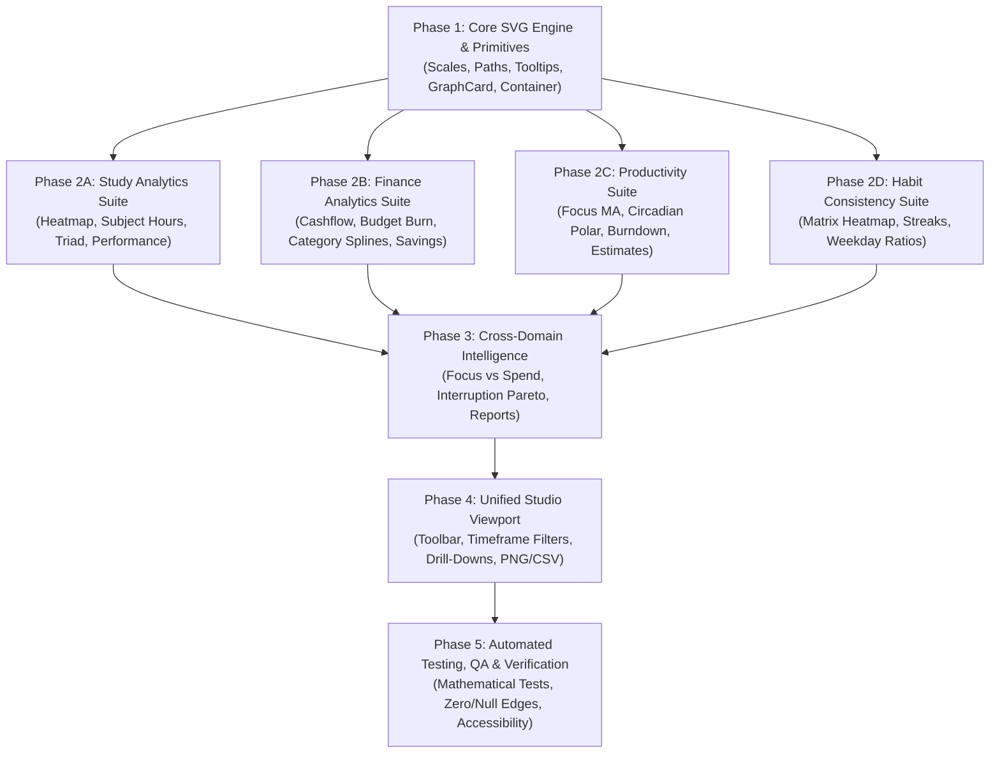

# FocusFlow & Finance — Advanced Graph Studio Implementation Plan
**Project:** FocusFlow & Finance v1.8.0  
**Document:** `docs/GRAPH_STUDIO_IMPLEMENTATION_PLAN.md`  
**Role:** Senior Frontend Developer, Data Visualization Architect, and QA Engineer  
**Status:** Implementation Roadmap (Phased Execution, Zero Third-Party Bundles, Zero AI)

---

## 1. Executive Summary & Delivery Strategy

This document defines the actionable, phased implementation roadmap for introducing the **Advanced Graph Studio** into FocusFlow & Finance. 

To maintain system stability, preserve 100% test coverage, and prevent regression across existing tabs, the implementation follows a strictly modular, bottom-up architectural progression:



---

## 2. Phased Implementation Roadmap

---

### Phase 1: Core Visualization Primitives & Mathematical Engine
*Deliverable:* Standalone, zero-dependency SVG visualization engine and standardized component wrappers.

1. **`src/components/graph-studio/core/GraphScales.ts`**:
   - `scaleLinear(value, domain, range, clamp?)`: Pure math linear mapper.
   - `scaleTime(date, domain, range)`: Epoch timestamp coordinate mapper.
   - `scaleBand(item, domain, range, padding)`: Discrete bar column distributor.
   - `getNiceTicks(min, max, count)`: Generates clean human-readable axis ticks ($0, 25, 50, 75, 100$ or clean currency steps).
2. **`src/components/graph-studio/core/GraphPathGenerators.ts`**:
   - `generateSmoothSplinePath(points)`: Computes Catmull-Rom or cubic Bezier spline SVG path string (`M ... C ...`).
   - `generateAreaPath(points, baselineY)`: Generates closed SVG path for gradient fills.
   - `generateStepPath(points)`: Generates orthogonal stepped lines for cumulative balance and burndown.
3. **`src/components/graph-studio/core/GraphSvgContainer.tsx`**:
   - Responsive vector viewport wrapper utilizing `viewBox="0 0 W H"` with `preserveAspectRatio="xMidYMid meet"`.
   - Integrated with `ResizeObserver` for adaptive container query width adjustments.
4. **`src/components/graph-studio/core/GraphTooltip.tsx`**:
   - Mouse-tracking floating popover with magnetic snapping to the nearest data point.
   - Flip logic preventing off-screen overflow on mobile viewports.
5. **`src/components/graph-studio/core/GraphCard.tsx`**:
   - Standardized card container with header title, domain badge, legend indicator, fullscreen expand, CSV export, and PNG download triggers.
6. **`src/components/graph-studio/core/GraphExport.ts`**:
   - `exportSvgToPng(svgElement, fileName)`: Serializes SVG DOM into high-resolution Canvas and triggers PNG download.
   - `exportDatasetToCsv(filename, headers, rows)`: Formats tabular data and initiates instant CSV download.

---

### Phase 2: Domain-Specific Graph Suites

#### Phase 2A: Study OS Analytics Suite (`src/components/graph-studio/study/`)
1. **`StudyActivityHeatmap.tsx`**:
   - 84-day to 365-day square matrix showing study volume.
   - Hover reveals date, study minutes, sessions count, and active subjects.
2. **`SubjectStudyHoursChart.tsx`**:
   - Horizontal ranked bars with subject color swatches.
   - Displays total study hours and percentage share.
3. **`StudyTrendsVelocityChart.tsx`**:
   - Weekly and monthly study hours spline with previous period comparison guide.
4. **`SyllabusTriadProgressChart.tsx`**:
   - Segmented progress bar for Theory %, Practice %, and PYQ % per subject.
5. **`SubjectPerformanceChart.tsx`**:
   - Clustered comparison of actual published exam scores, quiz percentages, and revision recall scores.
   - Graceful informational empty state when no test marks have been logged.

#### Phase 2B: Finance Analytics Suite (`src/components/graph-studio/finance/`)
1. **`MonthlyCashflowChart.tsx`**:
   - Dual-column vertical bars (Inflow vs Outflow) with floating monthly savings rate badge.
2. **`BudgetVsActualSpendingChart.tsx`**:
   - Envelope budget burn rate comparison with color threshold transitions ($<80\%$, $80\text{--}99\%$, $\ge 100\%$).
3. **`CategorySpendingTrendsChart.tsx`**:
   - Multi-line category spending trajectory over consecutive months.
4. **`SavingsGrowthTrendChart.tsx`**:
   - Actual accumulated savings area curve against linear milestone velocity target.
5. **`LiquidCashflowTimelineChart.tsx`**:
   - Cumulative net balance spline with shaded surplus/deficit areas.

#### Phase 2C: Productivity Analytics Suite (`src/components/graph-studio/productivity/`)
1. **`FocusHoursTrendChart.tsx`**:
   - Daily focus column histogram overlaid with a smooth 7-day moving average curve and daily goal line.
2. **`CircadianHeatmapChart.tsx`**:
   - 24-hour radial polar chart or weekday-by-hour matrix identifying biological peak flow hours.
3. **`TaskVelocityTrendChart.tsx`**:
   - Daily completed tasks by priority alongside cumulative velocity curve.
4. **`TaskBurndownChart.tsx`**:
   - Sprint-style burndown comparing actual remaining tasks against ideal linear pace.
5. **`EstimatedVsActualFocusChart.tsx`**:
   - Comparison of planned Pomodoros vs actual elapsed duration, highlighting planning bias.

#### Phase 2D: Habit Consistency Suite (`src/components/graph-studio/habits/`)
1. **`HabitCompletionMatrix.tsx`**:
   - Grid tracking completion status across all active habits for the selected timeframe.
2. **`HabitStreakLongevityChart.tsx`**:
   - Horizontal range bars comparing current streak against all-time best streak.
3. **`WeekdayConsistencyChart.tsx`**:
   - 7-day weekday consistency radar/bar chart (Monday through Sunday).
4. **`HabitCategoryDistributionChart.tsx`**:
   - Adherence percentages grouped by personal growth category.

---

### Phase 3: Cross-Domain Intelligence & Custom Reports (`src/components/graph-studio/custom/`)
1. **`FocusVsSpendCorrelationChart.tsx`**:
   - Synchronized dual-axis time-series plotting Daily Focus Minutes on Left Y-Axis and Daily Discretionary Spending on Right Y-Axis.
   - Displays Pearson's $r$ correlation index and deterministic plain-language interpretation.
2. **`InterruptionParetoChart.tsx`**:
   - 80/20 Pareto chart plotting interruption root causes against cumulative percentage line.
3. **`ExecutiveReportSummary.tsx`**:
   - Cross-domain KPI comparison cards and unified printable executive summary.

---

### Phase 4: Main Studio Viewport & Deep Linking Navigation
1. **`GraphStudioToolbar.tsx`**:
   - Domain selector tabs (`All`, `Study OS`, `Finance`, `Productivity`, `Habits`, `Custom Reports`).
   - Timeframe filter (`Today`, `7D`, `30D`, `90D`, `180D`, `1Y`, `All`, `Custom Range`).
2. **`AdvancedGraphStudio.tsx`**:
   - Main container with lazy-loaded domain sections, query parameter state synchronization, and keyboard shortcuts.
3. **Click-Through Deep Linking Router:**
   - Connect chart element clicks directly to underlying views (`TransactionsLedger`, `StudyView`, `DailyTimeline`, `BillsTracker`).
4. **Navigation Integration:**
   - Add "Graph Studio" entry to primary application navigation and Command Center (`CommandCenter.tsx`).

---

### Phase 5: Automated Testing, Accessibility & Release QA
1. **Unit & Mathematical Tests (`test/graph_studio_math.test.ts`):**
   - Verify `scaleLinear`, `scaleTime`, `scaleBand`, and `generateSmoothSplinePath`.
   - Test Pearson correlation calculation with known positive, negative, and zero-variance series.
   - Test moving average calculations on edge cases (fewer than 7 days, zero days).
2. **Data Aggregation Tests (`test/graph_studio_aggregation.test.ts`):**
   - Verify tenant isolation on all queries (`userId` partitioning).
   - Test empty datasets return empty arrays without `NaN`, `null`, or division-by-zero crashes.
   - Test multi-timezone date handling using `formatDateInTimezone`.
3. **Visual & Accessibility Audits:**
   - Verify all charts provide valid `role="img"` and `aria-label`.
   - Verify all animations disable immediately when `prefers-reduced-motion` is active.
   - Verify color contrast across light mode and 18+ dark theme tokens.
4. **Regression Verification:**
   - Confirm existing 801 tests continue passing with zero regressions.

---

## 3. Risk Mitigation & Technical Safeguards

```
+-----------------------------------+-----------------------------------+---------------------------------------+
| Potential Risk                    | Root Cause                        | Mitigation Strategy                   |
+-----------------------------------+-----------------------------------+---------------------------------------+
| 1. High Memory on Dense SVGs      | Generating 1,000+ DOM circle nodes| Render single continuous <path> spline|
|                                   | for long time series.             | and generate circles on-demand only.  |
| 2. Re-render Lag on Tooltip Move  | Parent component state update on  | Isolate tooltip state in lightweight  |
|                                   | mouse coordinates.                | local overlay without re-rendering SVG|
| 3. Firestore Read Inflation       | Re-fetching collections on every  | Route all requests through clientData |
|                                   | timeframe or tab change.          | Cache with in-flight deduplication.   |
| 4. Division by Zero in Ratios     | Zero income, zero tasks, or zero  | Safe math fallbacks: max(1, denominator)|
|                                   | study topics in early accounts.   | or explicit zero-edge guards.         |
| 5. Theme Switching Flicker        | Canvas redraw latency across 18+  | Pure SVG CSS custom properties        |
|                                   | dynamic visual themes.            | (var(--ff-*)) updating on the GPU.    |
+-----------------------------------+-----------------------------------+---------------------------------------+
```

---

## 4. Verification & Sign-Off Checklist

```
[ ] docs/GRAPH_STUDIO_DESIGN.md complete and verified against source
[ ] docs/GRAPH_DATA_MAPPING.md complete with exact fields and formulas
[ ] docs/GRAPH_STUDIO_IMPLEMENTATION_PLAN.md complete with phased delivery
[ ] Zero source code modifications made during design phase
[ ] TypeScript compiler typecheck passes with 0 errors
[ ] Full workspace test suite passes with 801/801 passing tests
```
