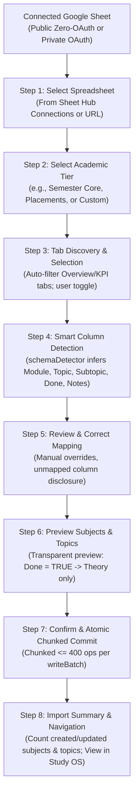

# Sheet Hub → Study OS Import Bridge: Architecture & Smart Mapping Design

**Document:** `SHEET_TO_STUDY_MAPPING_DESIGN.md`  
**Phase:** Step 2 — Architecture & Design Specification  
**Status:** Approved Design (Non-Implementation)  
**Related Documents:** `SHEET_TO_STUDY_DATA_MODEL.md`, `SHEET_TO_STUDY_REIMPORT_RULES.md`, `SHEET_TO_STUDY_AUDIT.md`

---

## 1. High-Level Architecture & End-to-End Workflow

The **Sheet Hub → Study OS Import Bridge** transforms external tabular curriculum spreadsheets (e.g. Semester syllabi, GATE tracker sheets, coding roadmaps) into native academic courses (`StudySubject`) and syllabus checkpoints (`StudyTopic`) within NextStudy OS.

### End-to-End Workflow Diagram



---

## 2. 8-Step Interactive User Workflow

### Step 1: Select Spreadsheet Source
- **Entry Points:**
  1. *Sheet Hub Workspace Header:* "Import to Study OS" button in the active spreadsheet toolbar.
  2. *Sheet Hub Connection Card:* Kebab menu item "Import to Study OS".
  3. *Study OS Header:* Action button "Import from Google Sheet" adjacent to "Add Subject".
- **Source Selection:**
  - If triggered from an active Sheet Hub connection, the spreadsheet is pre-selected.
  - If triggered from Study OS, users can choose from already connected spreadsheets or paste a new public/private Google Sheets URL.

### Step 2: Target Academic Tier Selection
- In FocusFlow Study OS, every `StudySubject` is organized under an `AcademicTier` (e.g. `tier1_sem3` = College Semester Core, `tier2_placements` = Placements & SDE, `tier3_gate` = GATE Depth).
- The dialog presents an interactive radio group populated dynamically via `api.getStudyTiers()`.
- Users can also create a new Tier on the fly (e.g., "Semester 4 Core", "UPSC CSE").

### Step 3: Tab Selection & Subject Configuration
- **Automatic Discrimination:**
  - Evaluates `tab.role` from `schemaDetector.ts`.
  - Automatically unchecks and tags tabs matching `OVERVIEW_TAB_NAME_REGEX` (`Overview`, `Summary`, `Dashboard`, `KPI`, `Instructions`) or where formula columns exceed 50%.
- **Subject Target Mapping per Tab:**
  - Each selected tab displays:
    - **Tab Title:** e.g., `DBMS`
    - **Target Action:** Segmented toggle: `[ Create New Subject ]` or `[ Map to Existing Subject ]`
    - **Course Name:** Auto-filled from tab title (editable, e.g. "Database Management Systems")
    - **Subject Code:** Auto-generated clean uppercase slug (e.g., `Sub_DBMS`). Validates against collision with existing subjects.
    - **Color Accent:** Auto-assigned palette color.

### Step 4 & 5: Smart Column Detection & Mapping Review
- Utilizes the existing `schemaDetector.ts` inference engine.
- Matches headers case-insensitively with alias support:

| Canonical Field | Target Role | Primary Heuristics & Keywords | Study OS Property |
|---|---|---|---|
| **Module / Unit** | `group` | `module`, `unit`, `chapter`, `section`, `part`, `phase` | `StudyTopic.unit` |
| **Topic** | `subgroup` | `topic`, `theme`, `area`, `sub-section`, `concept-group` | `StudyTopic.topic` |
| **Subtopic** | `title` | `subtopic`, `item`, `title`, `name`, `concept`, `lesson` | `StudyTopic.subtopic` *(Required)* |
| **Done / Checkbox** | `done` | `done`, `completed`, `status`, `chk`, `finish`, `studied` | `StudyTopic.theory` *(Default)* |
| **Notes / Practice**| `notes` | `notes`, `practice`, `comments`, `remarks`, `details`, `url` | `StudyTopic.notes` |
| **Priority** | `priority` | `priority`, `severity`, `importance`, `urgency` | `StudyTopic.priority` |

- **User Mapping Controls:**
  - Shows mapped columns with visual pills.
  - Exposes dropdown selectors to re-assign or unmap columns.
  - Lists **Unmapped Columns** explicitly with gray badges so users know exactly which spreadsheet data is omitted.
  - Ambiguous columns (e.g., headers named "Data", "Col 4") are **never guessed silently**; they are marked `Unmapped` until user assigns them.

### Step 6: Transparent Progress Preview
- Previews the hierarchical tree: `Tier → Subjects → Topics`.
- **Progress Rule Transparency:**
  - Explains the default mapping rule clearly:
    > **Progress Rule:** Rows where `Done = TRUE` will be marked with **Theory: Completed**. Practice and PYQ will remain **Pending** to encourage hands-on problem solving.
  - Topic cards in preview display badges:
    `[ Theory: Completed ]` or `[ Theory: Pending ]`
    `[ Practice: Incomplete ]`
    `[ PYQ: Incomplete ]`
- Displays summary statistics before commit:
  - Total Subjects to create / update
  - Total Topics to import
  - Total Pre-completed Theory topics

### Step 7: Atomic Chunked Ingestion
- Executes client-side under the authenticated user's Firebase session.
- Subdivides operations into chunks of **$\le 400$ writes per `writeBatch`** to respect Cloud Firestore's 500-write limit.
- Automatically calculates `totalSubtopics` and `completedSubtopics` counts on each `StudySubject`.

### Step 8: Import Summary & Deep Link
- Displays a completion receipt:
  - `4 Subjects Created (Prob & Stats, COA, DBMS, Python)`
  - `597 Topics Imported (9 Theory Completed)`
- Offers a direct navigation button: `[ Open in Study OS → ]`.

---

## 3. Tab Mapping & Disambiguation Logic

### Tab Filtering Rules
```typescript
function isTabEligibleForStudySubject(tab: SheetTabSchema): { eligible: boolean; reason?: string } {
  const normTitle = tab.sheetTitle.trim().toLowerCase();
  
  // 1. Role-based check
  if (tab.role === 'overview' || tab.role === 'ignored') {
    return { eligible: false, reason: 'Detected as Summary/Overview tab' };
  }
  
  // 2. Keyword check
  if (/\b(overview|summary|dashboard|kpi|readme|guide|index|instructions)\b/i.test(normTitle)) {
    return { eligible: false, reason: 'Summary tab title' };
  }
  
  // 3. Formula dominance check
  const formulaCols = tab.columns.filter((c) => c.inferredType === 'formula' || !c.editable);
  if (tab.columns.length > 0 && formulaCols.length / tab.columns.length >= 0.6) {
    return { eligible: false, reason: 'Formula-dominated summary tab' };
  }
  
  return { eligible: true };
}
```

### Subject Code Generation & Collision Prevention
1. **Initial Slug:** Remove non-alphanumeric characters, take uppercase first 8 characters:
   `DBMS` $\to$ `Sub_DBMS`
   `Prob & Stats` $\to$ `Sub_PROBSTATS`
2. **Collision Check:**
   Query existing `study_subjects` for `code === candidateCode`.
   - If user chose **"Map to Existing Subject"**: Re-use existing subject's `id` and `code`.
   - If user chose **"Create New Subject"**:
     Append numerical suffix: `Sub_DBMS_2`, `Sub_DBMS_3` to prevent violating Firestore security rules or colliding with active study tracks.

---

## 4. Progress Preservation Invariant (Theory vs. Practice)

In NextStudy OS:
$$\text{Topic Completed} \iff (\text{Theory} = \text{true}) \land (\text{Practice} = \text{true})$$

When importing external syllabus sheets:
- Rows marked `Done = TRUE` represent initial conceptual coverage.
- To prevent false completion inflation, the bridge enforces the **Progress Preservation Invariant**:

$$\text{Sheet Done} = \text{TRUE} \implies \begin{cases} \text{Theory} = \text{true} \\ \text{Practice} = \text{false} \\ \text{PYQ} = \text{false} \\ \text{RevisionCount} = 0 \end{cases}$$

$$\text{Sheet Done} = \text{FALSE} \implies \begin{cases} \text{Theory} = \text{false} \\ \text{Practice} = \text{false} \\ \text{PYQ} = \text{false} \\ \text{RevisionCount} = 0 \end{cases}$$

This ensures students are credited for reading the syllabus theory, while their hands-on Practice metrics and Revision ladders remain pristine and unpolluted.
