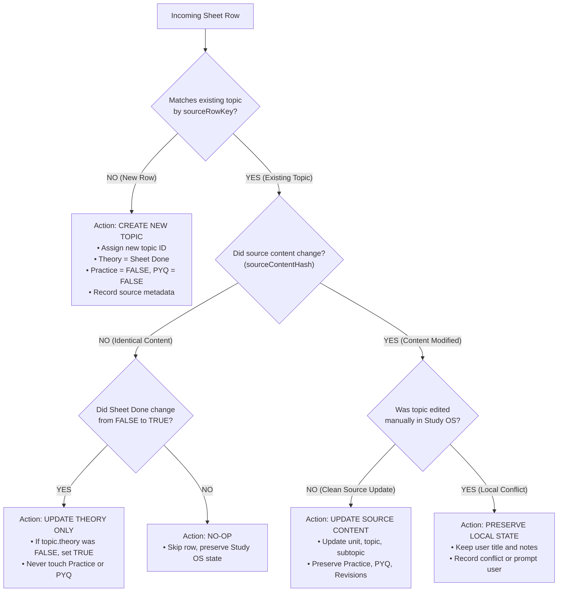

# Sheet Hub → Study OS Import Bridge: Re-import & Reconciliation Rules

**Document:** `SHEET_TO_STUDY_REIMPORT_RULES.md`  
**Phase:** Step 2 — Architecture & Design Specification  
**Status:** Approved Design (Non-Implementation)  
**Related Documents:** `SHEET_TO_STUDY_MAPPING_DESIGN.md`, `SHEET_TO_STUDY_DATA_MODEL.md`

---

## 1. Field Ownership Matrix

To prevent data corruption, accidental progress loss, or unintended overwrites during repeated imports, every property in a `StudyTopic` is assigned a strict ownership boundary:

| Field | Owner | Mutated by Initial Import? | Mutated by Re-Import? | Notes |
|---|---|:---:|:---:|---|
| `id` | **System** | Yes (Generated) | **Never** | Permanent Firestore document ID |
| `userId` | **System** | Yes | **Never** | Authenticated user UID |
| `subjectCode` | **System** | Yes | **Never** | Foreign key to `StudySubject.code` |
| `unit` | **Source Sheet** | Yes | **Conditional** | Updates only if `sourceContentHash` changed |
| `topic` | **Source Sheet** | Yes | **Conditional** | Updates only if `sourceContentHash` changed |
| `subtopic` | **Source Sheet** | Yes | **Conditional** | Updates only if `sourceContentHash` changed |
| `notes` | **Shared** | Yes | **Preserved** | Preserves user notes; appends source notes if empty |
| `priority` | **Source Sheet** | Yes | Yes | Adopted from sheet priority column |
| `rowIndex` | **Source Sheet** | Yes | Yes | Sequence updated to match new sheet layout |
| `theory` | **User Progress** | Yes (Initial only) | **Protected** | **Never reset to false** on re-import |
| `practice` | **User Progress** | **Never** (Set false) | **Protected** | **Never overwritten** on re-import |
| `pyq` | **User Progress** | **Never** (Set false) | **Protected** | **Never overwritten** on re-import |
| `revisionCount`| **User Progress** | **Never** (Set 0) | **Protected** | **Never overwritten** on re-import |
| `isBookmarked` | **User Progress** | **Never** (Set false) | **Protected** | **Never overwritten** on re-import |
| `deletedAt` | **User Progress** | **Never** (Set null) | **Protected** | Soft-deleted topics are never resurrected |
| `source*` | **Source Meta** | Yes | Yes | Metadata timestamps and hashes |

---

## 2. Re-import Scenarios & Deterministic State Machine



---

## 3. Detailed Scenario Walkthroughs

### Scenario 1: Exact Match (No Changes)
- **Condition:** An incoming sheet row matches an existing `StudyTopic` by `sourceRowKey`, and `sourceContentHash` is identical.
- **Action:** **NO-OP**.
- **Result:** The row is skipped. No Firestore writes are consumed. `lastImportedAt` is updated on the parent subject.

### Scenario 2: Source Content Modified (e.g. Typo Fixed in Sheet)
- **Condition:** Incoming row matches `sourceRowKey`, but `sourceContentHash` differs (e.g. Unit was renamed from `"Unit 1"` to `"Unit 1: Foundations"`).
- **Action:**
  - If the user has *not* manually modified this topic's title in Study OS:
    - Update `unit`, `topic`, `subtopic`, and `sourceContentHash`.
    - **Never** modify `practice`, `pyq`, `revisionCount`, or spaced repetition history.
  - If the user has customized the topic in Study OS:
    - Retain the user's custom title. Flag in import summary: *"1 topic preserved with local modifications."*

### Scenario 3: Source Done Status Changed
- **Case 3A: Sheet `Done` changed from `FALSE` to `TRUE`:**
  - If existing `StudyTopic.theory === false`:
    - Update `theory = true`.
    - Leave `practice` and `pyq` untouched.
  - If existing `StudyTopic.theory === true`:
    - Retain `theory = true`.
- **Case 3B: Sheet `Done` changed from `TRUE` to `FALSE` (Unchecked in sheet):**
  - **Critical Invariant:** **Never regress user progress.**
  - If the student already completed Theory in Study OS, an external uncheck in Google Sheets **must NOT** reset their Theory progress to false.

### Scenario 4: New Row Inserted in Source Sheet
- **Condition:** An incoming row's `sourceRowKey` does not exist among the subject's active topics.
- **Action:**
  - Create a new `StudyTopic`.
  - Set `theory = (Sheet Done == true)`.
  - Set `practice = false`, `pyq = false`, `revisionCount = 0`.
  - Record `sourceRowKey`, `sourceContentHash`, and `importedAt`.
  - Increment parent `StudySubject.totalSubtopics`.

### Scenario 5: Row Deleted in Source Sheet (Orphaned Topics)
- **Condition:** An existing `StudyTopic` has a `sourceRowKey` that is no longer present in the newly fetched spreadsheet.
- **Critical Safety Invariant:** **Never delete Study OS data based on sheet deletions.**
  - Students may have attached notes, logged mistakes, or completed revisions against this topic.
  - Deleting it would destroy academic history.
- **Action:**
  - Preserve the topic in Study OS.
  - Mark `isSourceOrphaned = true` in topic metadata (optional visual tag in syllabus).

### Scenario 6: Soft-Deleted Topics in Study OS
- **Condition:** A user previously clicked "Delete Topic" inside Study OS (`deletedAt !== null`), but the row still exists in the spreadsheet.
- **Action:**
  - Do **NOT** resurrect the deleted topic.
  - Respect the user's intentional deletion in Study OS.

---

## 4. Reconciliation Algorithm Specification

```typescript
export interface ReconciliationPlan {
  topicsToCreate: StudyTopic[];
  topicsToUpdate: Array<{ id: string; updates: Partial<StudyTopic> }>;
  topicsToSkipCount: number;
}

export function reconcileSheetRowsWithStudyTopics(
  incomingRows: SheetSyncedRow[],
  existingTopics: StudyTopic[],
  mapping: TabToSubjectMapping,
  userId: string
): ReconciliationPlan {
  const existingByKey = new Map<string, StudyTopic>();
  for (const t of existingTopics) {
    if (t.sourceRowKey && !t.deletedAt) {
      existingByKey.set(t.sourceRowKey, t);
    }
  }

  const topicsToCreate: StudyTopic[] = [];
  const topicsToUpdate: Array<{ id: string; updates: Partial<StudyTopic> }> = [];
  let topicsToSkipCount = 0;
  const nowIso = new Date().toISOString();

  for (let idx = 0; idx < incomingRows.length; idx++) {
    const row = incomingRows[idx];
    const unit = String(row.values[mapping.columns.find(c => c.targetField === 'unit')?.fieldKey || ''] || 'General Unit');
    const topic = String(row.values[mapping.columns.find(c => c.targetField === 'topic')?.fieldKey || ''] || 'General Topic');
    const subtopic = String(row.values[mapping.columns.find(c => c.targetField === 'subtopic')?.fieldKey || ''] || '').trim();
    if (!subtopic) continue; // Skip empty concept rows

    const isDone = Boolean(row.values[mapping.columns.find(c => c.targetField === 'done')?.fieldKey || '']);
    const notes = String(row.values[mapping.columns.find(c => c.targetField === 'notes')?.fieldKey || ''] || '');
    const priority = (String(row.values[mapping.columns.find(c => c.targetField === 'priority')?.fieldKey || ''] || 'High')) as 'High' | 'Medium' | 'Low';

    const rowKey = computeSourceRowKey(mapping.sheetTitle, mapping.sheetId, mapping.targetSubjectCode, unit, topic, subtopic);
    const contentHash = computeContentHash(unit, topic, subtopic, notes);

    const existing = existingByKey.get(rowKey);

    if (!existing) {
      // Scenario 4: New Row
      topicsToCreate.push({
        id: `topic_${Date.now()}_${Math.random().toString(36).slice(2, 7)}`,
        userId,
        subjectCode: mapping.targetSubjectCode,
        unit,
        topic,
        subtopic,
        priority,
        theory: isDone,     // Done = TRUE -> Theory = true
        practice: false,    // Always false for new imports
        pyq: false,         // Always false for new imports
        revisionCount: 0,
        notes: notes || undefined,
        rowIndex: idx + 1,
        sourceOrigin: 'google_sheet',
        sourceSheetId: mapping.sheetId,
        sourceRowKey: rowKey,
        sourceContentHash: contentHash,
        importedAt: nowIso,
        lastImportedAt: nowIso,
        createdAt: nowIso,
        updatedAt: nowIso,
        deletedAt: null,
      });
    } else {
      // Existing topic match
      const updates: Partial<StudyTopic> = {};
      let needsUpdate = false;

      // Scenario 2: Content hash changed
      if (existing.sourceContentHash !== contentHash) {
        updates.unit = unit;
        updates.topic = topic;
        updates.subtopic = subtopic;
        updates.sourceContentHash = contentHash;
        needsUpdate = true;
      }

      // Scenario 3A: Theory completed in sheet while false in Study OS
      if (isDone && !existing.theory) {
        updates.theory = true;
        needsUpdate = true;
      }

      if (needsUpdate) {
        updates.lastImportedAt = nowIso;
        updates.updatedAt = nowIso;
        topicsToUpdate.push({ id: existing.id, updates });
      } else {
        topicsToSkipCount++;
      }
    }
  }

  return { topicsToCreate, topicsToUpdate, topicsToSkipCount };
}
```

---

## 5. Security, Invariant & Conflict-Free Guarantees

1. **Non-Destructive Guarantee:** Re-importing a Google Sheet will **never** delete existing topics, reset completed practice sessions, clear past question paper (PYQ) flags, or wipe spaced interval recall history.
2. **Deterministic Idempotency:** Running the import bridge multiple times consecutively against the same unchanged spreadsheet yields **0 creates, 0 updates, and 100% skips**.
3. **Tenant Boundary:** The reconciliation query strictly filters `where("userId", "==", auth.uid)`. No cross-tenant row matching can occur.
4. **Offline Resilience:** All reconciliation can compute client-side using `clientDataCache` before committing to Firestore, providing responsive previews even on high-latency mobile networks.
